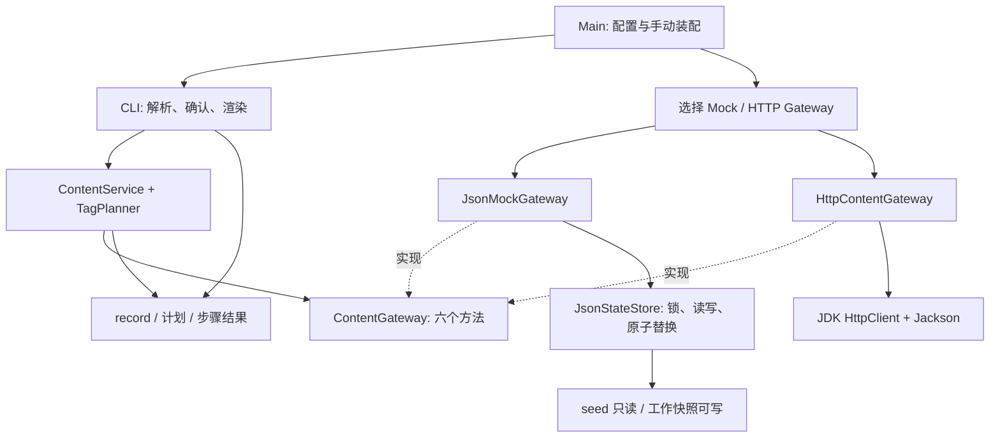
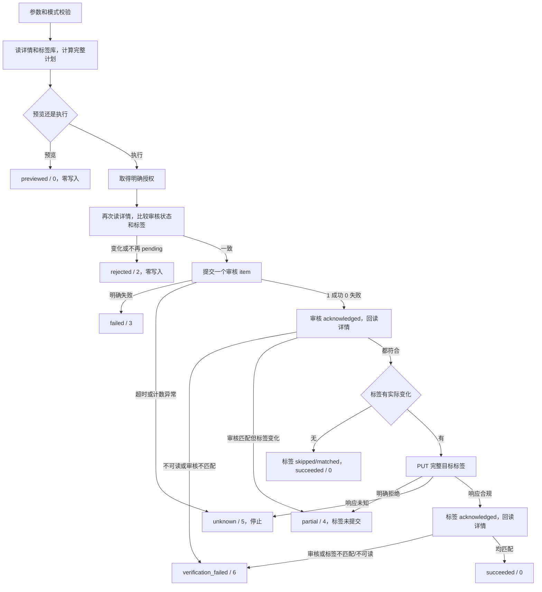

# Java 技术架构与实施方案

## 当前实现补记：交互式入口（2026-11-01）

交互式 Shell 已在代码提交 `93d9d586ba0c5b0c493ffed5c21f7c563acf11fe` 中完成。下文保留原设计阶段的事实与计划，不将历史“准备实现”改写成当时已实现；当前入口规则以本补记和根 README 为准。[既有 37 项专项和 247 项完整测试证据](../evidence/interactive-shell/README.md)来自实际开发验收，本次文档同步不重复构建或重跑这些测试。

```text
Main
 ├── 单次命令 → CliRunner
 └── InteractiveShell
      └── CommandTokenizer
           └── CliRunner
                └── ContentService
                     └── Gateway
```

无参数进入 Shell，有参数保持单次模式；help/exit/quit/EOF 由入口处理。Tokenizer 仅将引号、中文及空格整理为参数数组，业务参数解析仍由原 Picocli 命令树完成。每条命令重建解析上下文、按原规则读取最新状态，不增加业务缓存，也没有复制 ContentService 或 Gateway。

写入仍先生成合法计划。Shell 的 `--execute` 在 stderr 询问 y/N，默认 N；确认后才复用原 execute，取消保留原结果结构的 `cancelled / 7`，步骤为 not_sent。`--execute --yes` 不询问；单次及 `--non-interactive` 必须两项同时提供。命令循环与确认共用 Reader，提示不混入 JSON。Shell 正常退出进程为 0，各命令 JSON 保留各自 exit_code；不能用会话退出码代替逐条结果。

Shell 横幅 v1.1 与原 `--version` 的 0.1.0 显示口径暂不统一；本轮不改版本功能。Shell 不运行系统命令，不支持管道、重定向、变量展开、方向键历史或自动补全。浏览器 Playground 仍是独立内存模拟，不会执行真实 Java Shell。审核/标签依旧分开提交，原并发审核、标签覆盖及未知结果边界没有改变。

## 1. 设计结论、依据与实现状态

采用**单模块 Java CLI：Maven + Picocli + Jackson + JDK HttpClient + JUnit 5**。不启动 Web 服务，不引入 Spring Boot、SQLite、消息队列或任务平台。业务通过一个六方法 Gateway 接口访问 Mock 或 HTTP；Application Service 负责审核、标签和固定两步组合。

Mock 使用可跨进程读取的 JSON 工作快照，配合独立锁文件、同目录临时文件和原子替换。**一次 Mock API 写入**可以在同一快照内保存内容状态及其审核记录；**审核和标签这两次调用仍然分别提交**，不会被包装为一个事务。

### 1.1 已有、待实现与不实现

| 状态 | 内容 |
| --- | --- |
| 已有且本轮核查 | 原题、OpenAPI、mock_data.json、[01 分析](01-需求与接口分析.md)、[02 产品方案](02-第一阶段MVP与CLI产品方案.md)；本机 Java/Maven/PowerShell 版本；所选依赖的官方文档 |
| 本轮交付 | 本技术文档；其中目录、类型、伪代码、命令和测试结果条件均为待实现方案 |
| 48 小时准备实现 | Mock 驱动的最小 CLI、真实状态修改与持久化、核心错误分类、必要测试、HTML Demo、运行说明和真实 AI 协作记录 |
| 两周完整 MVP 准备实现 | 02 的完整 P0，包括标签 remove/set、交互确认、六项 HTTP 适配及完整回归；真实联调取决于实际环境是否提供 |
| 暂不实现 | 自动审核判断、100 条批处理/恢复、写入自动重试、强幂等、远程事务、额外后台 API、分布式组件 |

本轮没有初始化 Maven 项目、创建 Java/脚本实现、下载项目依赖、执行审核或修改原始附件。后文的构建与运行命令均是后续开发的验证方式，**不是已经成功运行的记录**。

### 1.2 已确认的产品合同

用户已确认：仅审核 pending，驳回必须有非空理由；只能新增 active 标签，存量废弃标签可以保留/移除；P0 不清空标签。这些规则放在 Application 层，不能伪装成上游原有校验。

沿用 02 的七个命令入口、默认预览、execute/yes、状态与退出码。存量未知标签仍按 02 的保留/移除策略处理，不允许新增。本文不修改 01/02；需要补充的少量合同边界集中列在第 11 节。

## 2. 技术选型与具体版本

### 2.1 本机环境事实

2026-10-31 在本工作区只读执行版本检查，得到：

| 项目 | 实测结果 | 对实施的影响 |
| --- | --- | --- |
| Java / javac | Eclipse Temurin OpenJDK **21.0.7+6 LTS**，javac 21.0.7 | 无须为了原型安装另一个 JDK；这不是“当前安全补丁最新版”的声明 |
| Maven | **3.9.4**，路径 `F:\Develop\apache-maven-3.9.4-bin\apache-maven-3.9.4` | 用现有 Maven；构建时固定项目依赖和插件，不因本机有更新缓存就随意换版本 |
| JAVA_HOME | `C:\Program Files\Eclipse Adoptium\jdk-21.0.7.6-hotspot` | 后续检查 Maven 实际使用的 Java 与此一致 |
| Shell / 编码 | PowerShell **7.6.5**；当前控制台输出编码 UTF-8 | Windows 首个验收环境明确；其他 Shell 的兼容性单列验证 |
| Maven 本地缓存 | 有 Picocli 4.7.6、部分 Jackson 2.21.x、部分 JUnit/插件缓存 | 目录存在不等于目标版本的完整依赖可离线构建；本轮未验证依赖解析，下一阶段首先做构建检查 |

### 2.2 三种 CLI 方案比较

| 方案 | 适合当前需求的部分 | 成本/不足 | 结论 |
| --- | --- | --- | --- |
| Java + Picocli | 多级命令、帮助、类型转换、重复选项、错误处理和退出码已有支持；可直接生成普通可执行 JAR | 需手动组装少量对象，自己定义业务输出合同 | **选择**，正好覆盖命令解析、业务编排、文件和 HTTP 调用 |
| Spring Boot + Picocli | 可使用依赖注入、配置和应用生命周期；已有 Spring 业务模块时便于复用 | 当前没有既有 Bean/服务可复用，会增加依赖、应用上下文和配置机制；默认启动日志还需避免污染 stdout | 不采用。Boot 能以非 Web 方式运行，并非一定启动 HTTP 服务；舍弃它是因为本项目收益不足，而不是技术上不能做 CLI |
| main 中自行解析 | 最少外部依赖，几个固定参数时可行 | 七个多级入口、重复标签、公共选项、帮助和解析错误需要自行维护；容易出现语法/JSON 错误合同分裂 | main 仅作启动入口，不承担手写参数解析器 |

上述比较是结合本项目的工程判断。Picocli 的能力见 [官方手册](https://picocli.info/)；Boot 的命令行与非 Web 启动能力见 [SpringApplication 文档](https://docs.spring.io/spring-boot/reference/features/spring-application.html)。不引用未实测的毫秒级启动或 JAR 体积指标。

### 2.3 JDK 选择：21 开发验收，release 17

选择本机 JDK 21 作为开发和首轮运行基线；Maven 配置 `maven.compiler.release=17`，仅使用 Java 17 已有语言/API，包括 record、java.time、NIO 和 HttpClient。这样可保留 Java 17 字节码兼容目标，无须引入 Java 21 专有功能。

这不等于已在 JDK 17 上运行通过；交付说明只声明实际测试的 JDK。若后续要求支持 17，再使用真实 JDK 17 跑同一套进程测试。不能一边 release=17，一边调用 JDK 21 新增的 HttpClient.close() 等 API。[Compiler 的 release 配置](https://maven.apache.org/plugins-archives/maven-compiler-plugin-3.14.1/examples/set-compiler-release.html)、[JDK 17 HttpClient](https://docs.oracle.com/en/java/javase/17/docs/api/java.net.http/java/net/http/HttpClient.html)。

不使用虚拟线程、预览语法、JPMS 模块化、GraalVM native image 或 jlink。单条同步流程没有对应收益。

依赖能否下载、默认 Maven 缓存能否写入尚未验证。后续 S0 若受缓存写权限限制，可通过 `-Dmaven.repo.local` 指向工作区 `.contentops/m2`，不要改系统 Maven 配置或为了凑本机缓存而静默降级依赖；网络/解析失败先记录为构建阻塞，不伪造已构建结果。

### 2.4 固定依赖与构建插件

以下是本方案的版本锁定值，不使用 LATEST、动态区间或自动升级：

| 用途 | Maven 坐标 / 版本 | 选择依据 |
| --- | --- | --- |
| 命令解析 | `info.picocli:picocli:4.7.7` | 官方文档对应的稳定版本，具备所需命令/异常处理能力；不加入 codegen 或 Spring 集成。[官方版本与手册](https://picocli.info/) |
| JSON 版本对齐 | import `com.fasterxml.jackson:jackson-bom:2.21.8` | 选择仍维护的 2.x LTS 分支补丁，不迁移 Jackson 3 的新包名/API；官方列出 2.21.8 已于 2026-10-17 发布。[2.21 发布说明](https://github.com/FasterXML/jackson/wiki/Jackson-Release-2.21) |
| JSON 运行库 | `com.fasterxml.jackson.core:jackson-databind`、`com.fasterxml.jackson.datatype:jackson-datatype-jsr310`，均由上述 BOM 管理 | 前者传递引入 core/annotations；后者处理 Instant。不要手动把每个组件都写成同一版本号，annotations 等组件按 BOM 实际版本对齐。[BOM 2.21.8](https://github.com/FasterXML/jackson-bom/blob/jackson-bom-2.21.8/pom.xml) |
| HTTP | JDK 自带 `java.net.http.HttpClient` | 无额外 Maven 依赖；同步发送即可，避免引入第二套 HTTP 框架 |
| 测试 | test scope `org.junit.jupiter:junit-jupiter:5.13.4` | 用户要求的 JUnit 5，含参数化和测试引擎；本需求不需要升级 JUnit 6。[5.13.4 官方指南](https://docs.junit.org/5.13.4/user-guide/) |
| 编译 | `maven-compiler-plugin:3.14.1` | 明确 release=17、源码 UTF-8；固定成熟版本，现有环境有缓存。[官方归档](https://maven.apache.org/plugins-archives/maven-compiler-plugin-3.14.1/) |
| 单测 / 进程集成测试 | `maven-surefire-plugin:3.5.5`、`maven-failsafe-plugin:3.5.5` | 前者跑 `*Test`，后者在 package 后跑 `*IT`；同版本便于统一配置。[Apache 3.5.5 发布](https://github.com/apache/maven-surefire/releases/tag/surefire-3.5.5) |
| 可执行 JAR | `maven-shade-plugin:3.6.2` | package 阶段整合运行依赖，写入 Main-Class；无需 Boot repackage。[官方用法](https://maven.apache.org/plugins/maven-shade-plugin/usage.html)、[可执行 JAR](https://maven.apache.org/plugins/maven-shade-plugin/examples/executable-jar.html) |
| 基础构建插件 | resources **3.3.1**、jar **3.4.2**、clean **3.4.1** | 固定默认生命周期插件，避免依赖 Maven 隐含的旧默认值。[Resources](https://maven.apache.org/plugins-archives/maven-resources-plugin-3.3.1/)、[JAR](https://maven.apache.org/plugins-archives/maven-jar-plugin-3.4.2/)、[Clean](https://maven.apache.org/plugins-archives/maven-clean-plugin-3.4.1/) |

不引入 Mockito：当前只有六方法 Gateway 需要替身，Recording/Fault Gateway 和真实临时工作副本更容易验证“是否真的写入”。Clock 可直接注入固定值。若后续出现难以替代的依赖再评估，不为 mock 而 mock。也暂不引入 Lombok、ORM、日志框架、OpenAPI 代码生成或完整 JSON Schema 校验库。

Jackson 配置要点：显式 JavaTimeModule、snake_case、时间输出 ISO-8601；接受响应扩展字段但显式校验写入必需字段；不启用多态 default typing。持久化使用 JsonNode 保留所有七类数据和未知字段，业务接口使用少量 record，不让 application 操作 JSON 树。

### 2.5 构建与打包合同

- 一个 Maven jar 模块，`artifactId=contentops`，初始版本 `0.1.0`，最终产物 `target/contentops.jar`。
- Shade 设置入口 `com.example.contentops.Main`，合并 services 资源，保留必要许可证；不 relocate、不 minimizeJar，避免反射序列化类型被删；不在项目根生成 dependency-reduced-pom。
- 原始 mock_data.json 作为**未过滤资源**复制到构建输出的 `seed/mock_data.json` 后打入 JAR；构建不重写附件。运行时以资源流读取 seed，无须再依赖附件所在目录。
- `mvn -B -ntp test` 跑单元/Mock 契约；`mvn -B -ntp verify` 先打包，再跑 Failsafe 的独立 JVM 测试；`mvn package` 不能代替完整 verify。
- 构建输出与 CLI 输出分开：不要通过 `mvn exec:java` 给脚本提供 JSON，Maven 日志可能混入 stdout。实际演示使用 `java -jar` 或薄启动脚本。

## 3. 整体架构与项目目录

### 3.1 依赖方向



Application 不依赖 Picocli、System.in/out、HttpClient、文件路径或 Jackson；Gateway 不认识退出码、确认提示和表格。Main 是唯一选择具体数据源并组装对象的地方。使用构造方法传依赖，不建 DI 容器。

手动装配分两段：先构建无 I/O 的命令树并完成解析；确认不是 help/解析错误后，才根据 root 中的 env 加载配置并创建 Gateway/Service。Main 可把一个组装函数传给 runner，在叶命令真正运行时调用；无需额外 Factory 接口或框架。否则在构造命令树时就读取状态/令牌，会破坏 help 不产生 I/O 的验收条件。

只保留一个业务 Gateway 接口。持久化、渲染、配置和标签计算都先用具体类；不为每层再加 ServiceImpl、RepositoryFactory、通用 CRUD、事件总线或一套内部 HTTP 服务器。

### 3.2 拟定目录（本轮不创建）

```text
AI_TESTEXAM/
├─ pom.xml
├─ src/main/java/com/example/contentops/
│  ├─ Main.java
│  ├─ cli/
│  │  ├─ RootCommand.java
│  │  ├─ ReadCommands.java
│  │  ├─ WriteCommands.java
│  │  ├─ CliRunner.java
│  │  ├─ Confirmation.java
│  │  └─ ResultRenderer.java
│  ├─ application/
│  │  ├─ ContentService.java
│  │  ├─ TagPlanner.java
│  │  └─ OperationRejected.java
│  ├─ gateway/
│  │  ├─ ContentGateway.java
│  │  └─ GatewayFailure.java
│  ├─ model/
│  │  ├─ ContentModels.java
│  │  ├─ OperationModels.java
│  │  └─ ResultModels.java
│  └─ infrastructure/
│     ├─ AppConfig.java
│     ├─ JsonSupport.java
│     ├─ mock/
│     │  ├─ JsonMockGateway.java
│     │  ├─ JsonStateStore.java
│     │  └─ FaultInjectingGateway.java
│     └─ http/HttpContentGateway.java             # 两周补齐
├─ src/test/java/com/example/contentops/
│  ├─ application/*Test.java
│  ├─ gateway/*Test.java
│  ├─ cli/*Test.java
│  ├─ integration/*IT.java
│  └─ support/RecordingGateway.java
├─ scripts/contentops.cmd
├─ demo/index.html
├─ docs/01-...、02-...、03-...、04-运行与演示说明.md
├─ docs/AI协作记录.md
├─ evidence/                                   # 真实执行证据，脱敏
└─ 内容运营后台接口数据/                       # 只读原始附件
```

ReadCommands 内放四个静态命令类，WriteCommands 内放三个；命名空间容器可嵌套在 RootCommand，避免每个空容器单开文件。model 中的相关小 record/enum 也可作为静态嵌套类型；不是要求按每个字段或每个状态生成文件。类型增大后再拆，不在本期预建空层。

### 3.3 关键类职责

| 类 | 责任与边界 |
| --- | --- |
| Main | 配置 UTF-8 流、创建 runner、按环境装配 service/gateway、最后调用 System.exit；业务步骤不写在 main |
| RootCommand / ReadCommands / WriteCommands | 保持 02 的命令树；解析选项为输入对象，调用 service；不直接改文件、不直接拼 HTTP |
| CliRunner | 安装解析/执行异常处理器；创建 invocation_id 和调用上下文；保证每次只渲染一个结果并返回同一个退出码；help 不初始化 Gateway |
| Confirmation | 依据输出模式、TTY、non-interactive、execute/yes，做本次授权；可在 CLI 单测中传入可控输入输出 |
| ResultRenderer | 同一个结果对象输出 JSON 或表格；先完整序列化再写 stdout；中途确认显示走 stderr |
| ContentService | 只读组合、生成计划、执行前检查、固定两步写入与核对、保留执行进度；统一判定业务结果 |
| TagPlanner | 纯函数：校验增删/替换、active/存量规则，计算完整目标标签、差异和 no-change；不访问 Gateway |
| ContentGateway | 六项现有能力的最小边界；返回事实 DTO 或 GatewayFailure，不决定 partial/退出码 |
| JsonMockGateway / HttpContentGateway | 分别实现本地模拟行为与真实 HTTP 序列化/解析；不增加 CLI 业务规则 |
| JsonStateStore | 一次读或一次更新的锁、最新快照加载、临时文件提交；不把审核与标签合并提交 |
| FaultInjectingGateway | 只在 Mock 的显式受控场景中使用；可在真正持久化后抛“响应丢失”，不靠打印失败制造假证据 |
| AppConfig / JsonSupport | 环境与路径校验、敏感配置；集中 Jackson 配置。AppConfig 不是第二套业务参数解释器 |

## 4. 六项 Gateway、DTO 与 API 契约

### 4.1 方法映射

以下是签名设计，不是已经生成的接口源码：

```text
ContentGateway
  Page<ContentSummary> listContents(ContentQuery query)
  ContentDetail getContent(String contentId)
  List<ReviewLog> getReviewLogs(String contentId)
  ReviewCounts submitReviews(List<ReviewItem> items)
  List<TagItem> listTags()
  TagAck replaceTags(String contentId, List<String> completeTags)
```

| Java 方法 | 现有 API | 必须保留的语义 |
| --- | --- | --- |
| listContents | `GET /admin/contents` | AND；固定 20 条/页；query 不带 page_size；summary 不带正文 |
| getContent | `GET /admin/contents/{content_id}` | 当前详情；每次需要核对时真的读取；不能用 plan 代替 |
| getReviewLogs | `GET /admin/contents/{content_id}/review-logs` | 全量历史；Mock 返回倒序；读取服务也可防御性排序，不丢 quality/visibility 动作 |
| submitReviews | `POST /admin/content-reviews` | DTO 正确保留 items 与两项计数；Application 永远传一个 item；重复调用的 API 行为仍是追加记录 |
| listTags | `GET /admin/tags` | 取全部；CLI 的 status/keyword 在应用读取后本地过滤 |
| replaceTags | `PUT /admin/contents/{content_id}/tags` | 请求为完整数组，无标签库校验；返回字符串 result，不硬编码必须等于 ok |

Gateway 保留 list 参数，是为了表达现有审核合同并测上限/重复行为，**不开放批量 CLI**。不定义一个没有上游对应的 process Gateway 方法。

### 4.2 必要模型

| 模型组 | 建议类型 | 说明 |
| --- | --- | --- |
| ContentModels | ContentSummary、ContentDetail、ReviewLog、TagItem、Page<T>、ContentQuery、ReviewItem、ReviewCounts、TagAck | 只建六项 API 所需模型，不建 Creator/Report/Promo 的 Java 实体；这些原始字段由树模型原样保存 |
| OperationModels | WriteSpec、ReviewDecision、TagChange、OperationPlan、ContentSnapshot、OperationKind | 区分用户意图与已计算的完整标签目标；OperationKind 只有 REVIEW/TAGS/PROCESS |
| ResultModels | CliResult<T>、WriteData、StepResult、CliError、UpstreamError、Outcome、WriteState、VerificationState | 字段及枚举对应 02；没有一个代表全部结果的 success:boolean |

DTO 的审核/质量/可见性和日志 action 可保留字符串，以便只读展示未识别的新值；写入 action 使用受限枚举转为 approve/reject。日期使用 Instant；原始工作树中的字符串仍原样保存。集合向上返回不可变副本，避免调用者直接改到持久化对象。

计数使用可判空的 Integer，并检查字段是否存在，避免缺失计数反序列化成 0。reason 未提供时计划可以为 null，但构造上游 JSON 必须省略该字段；不能发送 null 冒充 string。

不要为每个界面字段复制 Domain/DTO/VO 三套类。仅当 JSON 信封和上游响应结构不同才进行映射；文件 JSON 树局限在 infrastructure。

## 5. Mock：真实修改工作副本，而不是预设成功输出

### 5.1 JSON 与 SQLite 的比较

| 方案 | 本场景收益 | 需要承担的成本 | 决策 |
| --- | --- | --- | --- |
| 单一 JSON 工作快照 | 与约 200 KB 的原始数据结构接近；便于保留非本期字段、比对和重置；无 JDBC/表迁移 | 每次更新重写整个快照；必须自行处理锁、完整写入和错误分类 | **本期选择**，300 条规模和串行 CLI 足够；不声称适合长期高并发后台 |
| SQLite | 本地事务、查询和多表一致性更成熟 | JDBC 驱动、表结构、导入映射与迁移，以及原始数据字段/异常保留策略；仍不能使两个远程 API 原子提交 | 后续若有显著数据量、并行任务或历史查询需求再评估 |

SQLite 的提交/回滚机制确有价值，参见 [SQLite 原子提交说明](https://sqlite.org/atomiccommit.html)；当前取舍基于规模与交付成本，不是认为文件持久化天然比数据库可靠。

### 5.2 状态路径与格式

配置 `CONTENTOPS_STATE_DIR` 为绝对路径；默认 `${user.home}/.contentops/mock/v1`。演示和所有测试显式覆盖到项目的 `.contentops` 或临时目录，避免误用个人历史状态。切换工作目录不会改变已经配置的绝对状态位置。

```text
CONTENTOPS_STATE_DIR/
  state.lock                   固定名称，不随 state.json 替换
  state.json                   最近一次成功提交的完整快照
  state.<uuid>.tmp             本次提交的临时文件；正常结束后不残留
```

工作快照外层字段为 `state_schema_version=1`、`seed_sha256`、`revision`、`data`。data 保存原始根对象的全部七类数据和 `_note`，不只保存 contents；Java 不使用的字段仍保留。CLI 信封的 schema_version 与这个本地格式版本是两回事。

本次原始 seed SHA-256 为：

```text
44ba17cbe95432547a8fe380f81e0416ae51404957ed0c87de5ced7f8e3939b0
```

程序只读 JAR 中的 `/seed/mock_data.json`，不提供覆盖原始附件路径的写入参数。状态文件名固定，不能把 seed 路径当作 state.json。工作目录不允许放在原始附件目录内；对符号链接/重解析路径进行规范化检查，不向来源目录回写。

### 5.3 初始化、读取与重置

1. 每个 Gateway 调用都从磁盘重新加载，不能在构造函数读取一次后永久使用缓存。返回给 service 的 DTO 与工作树脱离。
2. state.json 不存在时，只读调用使用 seed 的内存副本；首次实际修改才提交 revision=1 的工作快照。不因第一次预览就写入“初始业务状态”。
3. state.json 已存在时校验格式版本、seed 指纹和 JSON 结构；损坏、指纹不符、字段缺失均明确失败，**不静默退回 seed**，以免把已做过的审核伪装成从未发生。
4. 原始数据中的日志时间冲突、废弃标签等不做自动清洗。只排序返回视图，不重写原始历史顺序来制造“干净来源”。
5. 重置采用**新建一个空的状态目录并切换环境变量**。不增加 mock reset 业务命令，不递归删除旧目录；旧工作副本可保留作为演示证据。

后续运行示例，需在已实现、已打包后于工程根目录执行：

```powershell
$env:CONTENTOPS_STATE_DIR = Join-Path (Get-Location).Path ('.contentops/demo-' + [guid]::NewGuid().ToString('N'))
java -jar ./target/contentops.jar --env mock content get ct_000004
```

上述只读命令可能初始化目录和锁文件等**协调元数据**，但不得创建/改写业务 state.json、增加日志或调用写方法。02 的“预览不写入”按业务快照和 POST/PUT 次数验收，不承诺整个文件系统绝无元数据变化。已有工作快照的预览前后 SHA、revision 必须不变。

### 5.4 写入与并发控制

对本机本地文件系统，每次 Gateway 读取/写入都获取同一个 sidecar 文件的排他 FileLock；数据很小，先不做读写共享锁优化。tryLock 最多等待 2 秒，取不到锁就明确失败，不无限阻塞。锁在 finally/try-with-resources 中释放；同一 JVM 的测试不得并发使用同一 store 实例绕过其串行约定。[FileLock 的跨进程及 JVM 内限制](https://docs.oracle.com/en/java/javase/21/docs/api/java.base/java/nio/channels/FileLock.html)。

一次更新的顺序是：

```text
取得 state.lock
  -> 读取最新 state.json（没有则读取 seed）
  -> 深拷贝并在内存执行这一次 API 的变更
  -> revision + 1；验证结构；生成完整 UTF-8 字节
  -> 在同一目录 CREATE_NEW 写唯一 tmp，写完全部字节并 FileChannel.force(true)
  -> 关闭 tmp 的句柄
  -> 原子移动 tmp 到 state.json
  -> 成功后才返回这一次 API 的成功响应
释放 state.lock
```

必须循环写完 ByteBuffer，不能假定一次 channel.write 就写全。不能先 truncate state.json 再慢慢序列化，也不能替换 state.lock 本身。

原子移动采用 ATOMIC_MOVE，但不能声称加上 REPLACE_EXISTING 就跨平台保证替换：JDK 文档明确 ATOMIC_MOVE 下其他选项被忽略，目标已存在时的替换行为与实现有关。因此首次写业务状态前，在同目录的独立探测文件上验证“原子创建与替换已有目标”可行；不支持时拒绝写入，**不降级为非原子覆盖**。探测不碰业务 state.json。[Files.move 合同](https://docs.oracle.com/en/java/javase/21/docs/api/java.base/java/nio/file/Files.html#move(java.nio.file.Path,java.nio.file.Path,java.nio.file.CopyOption...))。

force(true) 和原子替换可降低进程中断造成半份 JSON 的风险，但不构成对断电、磁盘损坏、所有网络盘和目录元数据持久化的完整承诺。[FileChannel.force](https://docs.oracle.com/en/java/javase/21/docs/api/java.base/java/nio/channels/FileChannel.html#force(boolean))。首轮支持本地磁盘；网络共享盘、同步盘不进入验收范围。

失败时的处理：

- 临时文件生成/force 失败且尚未进入替换：已知本次业务未提交，返回明确失败；保留旧快照，不重试写入。
- 替换或提交后的返回发生异常，无法证明是否提交：WRITE_UNKNOWN；不能因为没有返回成功就自动重做。
- 进程被杀死：锁随进程释放；下次只读取有效 state.json。残留 tmp 不自动选为最新状态，也不自动合并；损坏快照报错后由人核查/换新演示副本。
- 两周版可额外保留一份上一代 `.bak` 便于人工核查，但不是自动恢复依据，也不是 48 小时底线。

锁只覆盖**一次本地 Gateway 操作**，不跨人工确认，也不跨整个 process。两个不同内容的修改必须在锁内加载最新数据，避免互相覆盖；同一内容的两个操作仍可能在应用检查与写入之间竞争。不能给 Mock 偷加“整个 process 原子完成”的保证，让它表现得比真实 API 更安全。

### 5.5 Mock 六方法的行为

| 方法 | 本地行为 |
| --- | --- |
| listContents | 原始数组顺序作为本地稳定顺序，按支持字段 AND 过滤后分页 20；keyword 在标题/正文做包含匹配；投影 Summary。此排序/匹配细节是 Mock 选择，不扩大真实 API 保证 |
| getContent | 按 ID 返回当前详情；找不到给出 Mock 明确读取错误，不伪造真实服务的业务码 |
| getReviewLogs | 返回完整记录的倒序副本，空记录返回空数组；保留 limit/take_down 等全部动作 |
| submitReviews | 超过 20 拒绝，文档给出的 400 可作为 Mock 合同异常的 httpStatus，不编造业务 code；逐项统计已存在且输入有效的成功与失败；每个成功项修改 review_status，并追加一条含 action/reason/operator_id/created_at 的模拟日志；同一 API 提交的状态与日志在一次本地快照中保存，不外推真实批次原子性 |
| listTags | 返回全部标签；不替 CLI 过滤 active |
| replaceTags | 将 tags 替换为传入完整数组，不做 active/标签库检查；不附加审核日志。API schema 未限制空数组，Mock 若接受空数组也仅是模拟选择；CLI 的非空限制不由它代办 |

Mock Gateway 自身**不限制 pending、不强制 reject 理由、不禁止未知标签**；这些限制必须由 Application 实现。直接做 Gateway 契约测试时，重复审核应真的追加第二条日志，以证明 CLI 的防重复来自前置检查，而不是 mock 把重复写偷偷去重了。

审核批次没有成功项时不提交新工作快照；内部批量与异常项规则是为贴近现有合同的本地模拟，CLI 仍只传一项。存储读取失败归 READ_FAILURE；更新在提交前明确失败才归 REJECTED_NO_COMMIT，不能把所有锁/文件错误不分阶段地归为同一退出码。

新增日志使用注入的 Clock，模拟操作人可固定为 `op_mock_cli` 并说明来源；不声称真实审核日志一定透传这个值或接受调用者自报身份。真实操作日志 `op_api` 的局限仍存在。

只变更本期声明的内容字段和审核记录；creators.content_total/content_pending、tags.usage_count 等非本期聚合字段保留原值，不擅自实现未说明的聚合更新。CLI 没有这些额外查询能力，演示也不以它们作为写入正确性证据。

## 6. HTTP Gateway 与配置安全

### 6.1 实现边界

48 小时以 Mock 为验收数据源，不启动一个常驻 mock HTTP 服务，也不为暂时无法连接的地址部署反向代理。此时 `--env api` 明确返回 rejected / 2、API_ENV_NOT_IMPLEMENTED，不能回落为 mock。

两周版实现 HttpContentGateway 的六个方法，并使用**测试期间临时启动的本机 HTTP fixture**验证协议。该 fixture 不是产品服务器，也不是现有后台；真实联调仍须另外拿到可用地址与令牌。

### 6.2 序列化与响应

- 复用一个同步 HttpClient，不为每个请求创建 client。初版使用 HTTP/1.1、Redirect.NEVER，不配置自动 Authenticator；只按上游要求发送 X-Admin-Token。
- query 与每个 path segment 分别按 UTF-8 正确编码；不将 ID 或中文标签直接拼成未编码 URL，不用字符串替换模拟 URI 编码。
- 写请求固定 JSON Content-Type/Accept，Jackson 生成字节。审核 action 为小写 approve/reject；items 一项；标签传完整数组；可选 reason 缺省则省略。
- 按 JSON 节点检查关键响应字段后再转 DTO：计数必须存在且为合法整数、items 必须是数组、标签 Ack 必须有字符串 result；不能把缺失值默认成成功。
- GET 出现错误对象、畸形 JSON 或必需读取结构不可用：READ_FAILURE。写请求收到畸形/不合预期响应：WRITE_UNKNOWN，而不是自动再次请求。
- 真实错误保留可得的 HTTP 状态和业务 code/message，并脱敏；不从中文 message 猜可重试性。1/0、0/1 的审核计数分类由 service 完成。

明确拒绝与未知要保守区分：受控 Mock 的落库前拒绝、明确的单项 failed_count 可以标已失败；HTTP 侧可按确认过的认证拒绝或业务拒绝合同分类。当前没有业务码表，不能把所有 400/409/422 或全部非 2xx 都当成“肯定未写入”。未获确认的写入错误默认未知，待真实合同补全后再扩大明确拒绝规则。

### 6.3 超时与防重发

建议初始连接超时 3 秒、请求超时 10 秒，通过受控配置覆盖为正值；这是客户端设计值，不是服务端 SLA。同步调用不需要线程池/异步编排。请求体/响应体按 UTF-8，读取失败保持对应的读失败或写入未知。

应用没有重试循环仍不够：JDK 有内部重试设置。Main 必须在创建第一个 client 前固定以下 JVM 属性，不接受配置将其放宽：

```text
jdk.httpclient.disableRetryConnect=true
jdk.httpclient.enableAllMethodRetry=false
jdk.httpclient.redirects.retrylimit=1
```

同时关闭重定向与认证重试来源，不跟随 3xx 重新发送请求。[JDK 21 网络属性](https://docs.oracle.com/en/java/javase/21/core/java-networking.html) 描述了这些属性的含义；它们是 JDK 实现配置，不能仅看属性字符串就宣称所有运行时都已保证不重发。

HTTP 适配验收必须包括服务端接收计数、响应中断/超时、3xx 等场景，确认指定 JDK 下审核和标签各最多接收一次；未验证的 JDK 版本不承诺同样行为。无条件自动重试、followRedirects(NORMAL) 和 HTTP/2 扩展均不加入首版。写请求在 send 后超时/断流，原则上视为未知；仅能证明发生在发送前的配置/序列化错误才作未提交处理。

### 6.4 配置与敏感信息

| 配置 | 规则 |
| --- | --- |
| `--env` | 02 的命令参数，优先决定数据源；默认 mock，不自动探测网络后切换 |
| `CONTENTOPS_STATE_DIR` | Mock 绝对工作路径；缺省见 5.2；不使用当前目录寻找“任意一个 state.json” |
| `CONTENTOPS_API_BASE_URL` | 两周版 api 必填；拒绝 example.invalid、userinfo、query/fragment；初版要求根地址，不引入路径前缀重写 |
| `CONTENTOPS_ADMIN_TOKEN` | api 必填，只放认证头；不放 CLI 参数、URL、日志、HTML 或提交到仓库的配置样例中；环境变量并非密钥保险库，长期保管留给部署环境 |
| `CONTENTOPS_CONNECT_TIMEOUT_MS` / `CONTENTOPS_REQUEST_TIMEOUT_MS` | 默认 3000 / 10000；接受 1–120000 毫秒整数，这是客户端配置范围；配置错误为 2，不悄悄改成无限等待 |
| `CONTENTOPS_MOCK_SCENARIO` | 仅显式 Mock 受控演示使用，详见测试设计；api 环境设置该项时拒绝，防止把注入故障混成真实错误 |

api 常规环境要求 HTTPS，不关闭证书/主机名验证；纯本机测试 fixture 可使用 loopback HTTP，并在测试说明中标明。默认不打开 JDK HTTP headers/content 调试日志，以免泄露令牌或业务文本。异常消息也不能包含未经处理的认证配置、请求头或完整正文。

## 7. 三项写操作的代码级协作

### 7.1 先计划、再授权、再执行

ContentService 提供 `plan(WriteSpec)` 与 `execute(OperationPlan)` 两个主要写用例方法；独立审核、标签和 process 共用它们，通过 OperationKind 限定允许的步骤。读取方法可直接转发 Gateway 并做展示所需的过滤/排序。

OperationPlan 是本次调用内的不可变对象，包含：内容 ID、原审核状态与标签快照、审核决定/理由、完整目标标签、变更差异和 warnings。CLI 不能自己再算另一份标签计划；execute 也不能从用户参数重新计算后静默改变已确认的目标。

授权职责在 CLI：计划成功后，默认只返回 previewed；execute/yes 或交互确认通过才调用 execute。execute 内仍检查当前状态，不能因为拿到 plan 就跳过业务前置检查。这个内存对象不是审批文件、权限凭证或服务端锁。

```text
CLI write command:
  解析为 WriteSpec；校验 execute/yes/非交互组合
  plan = ContentService.plan(spec)
  若未带 execute：渲染 preview(plan)，返回 0
  若 JSON/非交互/无控制台 且缺 yes：渲染 rejected，返回 2
  若需要人工确认：向 stderr 显示计划，读取完整 ID
      取消/EOF/不匹配：渲染 cancelled，返回 7
  result = ContentService.execute(plan)
  CliRunner 包装同一个 result 为 JSON/表格并返回其退出码
```

### 7.2 计划计算

| 用例 | 计划阶段的读取与校验 |
| --- | --- |
| review | getContent；核对 ID/必要字段、pending、action、reject 理由；保存标签快照供执行前变化检查，但不查标签库 |
| tags update | getContent + listTags；保留当前审核状态作展示，不要求 pending；TagPlanner 计算完整非空目标并验证新增集合 |
| process | getContent + listTags；先完成全部审核/标签校验，再给出一个包含两步的计划；不允许先审核再发现非法标签 |

TagPlanner 的核心规则是集合差分：`newlyAdded = target - before`，只对 newlyAdded 要求库中 active；保留/移除的存量废弃或未知标签不被误拦截。目标与原标签集合相同则 hasTagChanges=false；输入冲突和非法值仍须先拒绝。

### 7.3 process 流程图



参数或读取在计划阶段失败时也立即返回，不进入授权/写入。流程图中成功、计数等均是预期条件，不是实测结果。

### 7.4 ContentService 的执行伪代码

以下是用于指导控制流的伪代码，不是本轮生成的 Java 实现：

```text
execute(plan):
  progress = 初始化已计划的步骤为 not_sent/not_checked
  current = getContent(plan.id)                   # 真正读取
  比较当前标签集合与 plan.before.tags
  review/process 还比较审核状态且要求 pending    # 变化则零写入 rejected

  if 包含 review:
    执行审核写调用，并把“调用进行中”记入 progress
    counts = submitReviews([一个 ReviewItem])
    if counts == (0, 1): 记录 review.failed，结束
    if counts != (1, 0): 记录 review.unknown，结束
    记录 review.acknowledged/not_checked
    observed = 回读详情
    if 不可读或审核不匹配: 记录 unavailable/mismatched，结束
    记录 review.verification=matched
    if 包含 tags 且 observed.tags != plan.before.tags:
      标签保持 not_sent，以 partial 结束

  if 包含 tags:
    if 目标集合没有变化:
      记录 tags.skipped/matched
    else:
      replaceTags(plan.id, plan.completeTargetTags)
      # 拒绝/未知分别保留，失败就停止，绝不自动再 PUT
      记录 tags.acknowledged/not_checked
      observed = 回读详情
      核对 tags；process 还核对所要求的审核状态
      标记各项 matched/mismatched/unavailable

  依据 progress 生成整体结果，不能只看最后一个 API 是否返回 200
```

写调用包装器必须在调用前记录正在执行哪个步骤，捕获 GatewayFailure 后保留先前成功状态。异常不是从最外层统一改成 failed/3：例如审核已获确认后的 GET 失败是 6，审核已核对成功后的标签明确拒绝是 4。

未执行的步骤不标 failed；未知的步骤不标 not_sent。最终回读发现审核后来被别人修改时，也要更新审核 verification 为 mismatched 并返回 6，即使标签已经匹配。

### 7.5 独立命令如何复用

- review 只有审核步骤，成功条件为计数 1/0 + 审核状态匹配，不执行标签 PUT。
- tags update 只有标签步骤；允许对 approved 内容补标签。无变化时 fresh read 已确认目标，返回 no_change/0、tags=skipped/matched，零 PUT。
- process 标签无变化时仍执行必要审核，整体为 succeeded；标签 skipped，不能声称标签写入成功。
- process 标签失败后的人工恢复使用独立 tags update，重新读取和计划；不重做 review，也不提供跳过审核的隐式 resume。

不要加 @Transactional。JsonStateStore 的一次快照替换只保证一个本地模拟 API 的提交边界；HTTP Gateway 不可能受本地事务保护。也不通过反向审核或覆盖旧标签做自动回滚。

## 8. 结果模型、异常与退出码

### 8.1 统一 Java 结果形状

采用如下 record/enum 形状，具体声明放在三个 model 文件中；字段命名经 JsonSupport 转为 02 的 snake_case：

```text
CliResult<T>(schemaVersion, invocationId, environment, command, mode,
             status, exitCode, contentId, T data, CliError error, warnings)
WriteData(plan, Map<步骤名, StepResult> steps, observed)
StepResult(write, verification, apiResult)
CliError(code, message, step, UpstreamError upstream)
UpstreamError(httpStatus, code, message)
```

StepResult.apiResult 只允许复制已收到的 `success_count / failed_count` 或 `result` 等小型字段 Map/null；不放 Throwable、认证头、HttpResponse 或文件对象。observed 永远来自最近一次成功读取，可以为空；不使用 plan.after 填充“实际状态”。reason/error/upstream 的 null 按 02 保留，不能全局 NON_NULL 后悄悄改变信封。

Outcome 在模型中绑定 wire 字符串和退出码：PREVIEWED、SUCCEEDED、NO_CHANGE 都对应 0，但 mode 不同；其余逐项见下表。不要在命令类里分别写一套状态/数值映射。枚举必须显式输出小写 wire 值，不能让 Jackson 默认输出 `ACKNOWLEDGED` 等大写 Java 名称。

| write 状态 | 含义 |
| --- | --- |
| not_sent | 没有调用该写方法，包括预览或前一步阻断 |
| acknowledged | 收到符合合同的成功响应；仍须核对 |
| failed | 已明确失败，不把不确定的网络错误放进来 |
| unknown | 可能已发生写入，但响应/计数不足以判定 |
| skipped | 目标无变化，明确省略该写入 |

verification 保持 `not_checked / matched / mismatched / unavailable`。预览的待写步骤必须是 not_sent/not_checked；只读命令没有写步骤。

### 8.2 异常只表达事实，service 按进度判定整体

| 异常/失败类型 | 使用位置 | 不应包含的假设 |
| --- | --- | --- |
| Picocli ParameterException | 参数语法/类型/重复选项，runner 转为 rejected/2 | 不把解析异常直接打印堆栈到 stdout |
| OperationRejected | pending、理由、标签、计划变化等本地业务限制 | 不代表服务端返回了同名业务码；审核已发生后不能再一律报“零写入” |
| GatewayFailure.READ_FAILURE | 读取失败、无法使用的响应、损坏工作文件 | 不固定映射 3；如果这是写后核对读取，必须是 6 |
| GatewayFailure.REJECTED_NO_COMMIT | 明确未提交的拒绝、Mock 落库前故障、锁获取失败等 | 不声称所有 HTTP 4xx 都符合此类 |
| GatewayFailure.WRITE_UNKNOWN | 写入超时/丢响应/无法解释响应/无法确认本地替换结果 | 不转为“失败后自动重试” |
| 非预期异常 | service 依据当前进度保留事实；runner 处理尚未执行业务的错误 | 不能丢掉已成功审核的记录或默认返回 0 |

GatewayFailure 保存受限的上游状态和脱敏消息，cause 仅供内部诊断，绝不直接序列化；不在 Gateway 里硬编码退出 4，因为它不知道之前是否已经审核成功。

### 8.3 结果判定表（保持 02）

| 情形 | 整体 status / 码 | 必须保留的步骤事实 |
| --- | --- | --- |
| 合法预览 | previewed / 0，mode=preview | 全部待写步骤 not_sent，state/revision 不变 |
| 完整执行且核对匹配 | succeeded / 0，mode=execute | 必要步骤 acknowledged/matched，允许合法 skipped/matched |
| 独立标签无变化 | no_change / 0，mode=execute | tags=skipped/matched，零 PUT |
| 参数/业务/确认方式拒绝，尚无写入 | rejected / 2 | 零写入；error 使用 CLI 代码 |
| 人工取消/EOF/输入 ID 不符 | cancelled / 7 | 零写入 |
| 只读/前置读取失败、无成功步骤时明确写失败 | failed / 3 | 具体步骤 not_sent 或 failed，不编造失败原因 |
| 审核已核对成功，标签明确失败或提交前被阻断 | partial / 4 | review acknowledged/matched，tags failed 或 not_sent |
| 任一写入未知 | unknown / 5 | 未知步骤为 unknown；之前成功保留，之后步骤不执行 |
| 已获确认但核对失败/不可读 | verification_failed / 6 | acknowledged 保留；verification 为 mismatched/unavailable；不撤销 |
| 写入前未分类内部错误 | failed / 1 | 无成功承诺；可能已写时按进度优先保留 5/6/4，而非统一压成 1 |

若 JVM 被杀死、stdout 写出失败或输出被截断，就不能保证给出完整 JSON；调用方按 02 视为无可信结果，不自动重放。正常结果先序列化到内存再输出，并检测输出错误；不能用成功退出掩盖结果根本没有交付。已完成业务但渲染失败时也不得重新执行用例来“补一份结果”。

单条审核收到 0/1 时只能知道这个 ID 失败，不能伪造逐项原因；收到 2/0 等不可能计数时为 5。写入未知不会因后来读取到目标值被提升为 succeeded。

## 9. Picocli、PowerShell 与进程接口

### 9.1 命令树与参数处理

RootCommand 名为 contentops，注册 content、tags 两个容器；content 下为 list/get/history/review/process 和 tags update，顶层 tags 下只有 list。与 02 完全相同。

- 公共选项在 root 定义 `scope=INHERIT`；叶命令通过同一个上下文取值，不复制七份环境/输出配置。标准帮助在各层可用。
- 每个叶命令实现 Callable<Integer> 或由统一 runner 返回结果码；不在子命令里调用 System.exit。
- action 是受限枚举；page 使用整数转换器及正数校验；标签用可重复的 List<String> 选项，每次 arity=1，不按逗号偷偷拆分标签名。
- **不使用 exclusive=false 的“共同出现” ArgGroup 强迫 add/remove 一起提供**。把标签选项放在同一 mixin/参数对象中，由共享校验验证“set 与增删互斥；增删至少一项；同值冲突”。可以用 validate=false 分组帮助，但不依赖错误的嵌套组自动校验。
- 不用一个互斥组表达 execute/yes：yes 依赖 execute，execute 又允许交互不带 yes，必须按模式做交叉校验。
- 显式关闭选项/子命令缩写、未知参数容忍、单值参数覆盖、@file 展开；只允许标签列表重复，重复 action 等为 2。避免原型默默获得输入文件或额外写入能力。

Picocli 的继承选项、ArgGroup 和异常处理依据 [官方命令手册](https://picocli.info/)。这些 API 是解析机制，pending/active 等规则仍不放在注解转换器里。

### 9.2 解析错误也要有 JSON

安装 IParameterExceptionHandler 与 IExecutionExceptionHandler，重用同一个 CliResult factory 和 renderer；默认 handler 会输出错误/usage，不能直接作为最终 JSON 合同。

推荐并支持的写法保持 `contentops [公共参数] 子命令...`。当用户先给合法 `--output json` 再发生 page/action/未知参数错误，handler 必须按 JSON 输出 rejected/2，而不是夹杂 usage。help 请求优先，不创建 Gateway 或读取令牌/状态。

参数解析可能在 command/mode 尚未确定时就中断。不要靠自己重新解释整份原始 args；此时 command/mode/content_id 可为空的补充建议见第 11 节。若 `--output` 本身非法或出现在解析停止点之后，按已成功解析的输出设置或默认 table 报错，不能承诺从损坏语法中猜出 JSON 意图。

### 9.3 确认、流和退出码

交互确认不使用 `@Option(interactive=true)`：那是参数读取机制，不等于对已经计算好的两步计划确认。Confirmation 只在 table、允许交互、System.console() 非空、execute 且无 yes 时向 stderr 展示计划，并从控制台读取完整 ID。JSON、non-interactive 或无 console 时缺 yes 必须返回 2，绝不尝试读取管道 stdin。

同一个进程只渲染一次最终结果。默认预览作为最终输出走 stdout；执行中计划/提示走 stderr。JSON 禁用 ANSI 和进度条，输出 UTF-8 无 BOM，任何解析/业务错误也走同一信封。

Main 只做“`exitCode = runner.run(args)`，最后 `System.exit(exitCode)`”；只返回 Java 方法的 int 而不 System.exit 会导致 JVM 正常退出 0，是必须用进程测试发现的问题。

### 9.4 Windows 调用与中文

分发保留逻辑命令名 contentops：Windows 提供薄 `scripts/contentops.cmd`，只转发参数到 JAR，结束时传回 Java 的 ERRORLEVEL；不安装全局别名，不悄悄吞掉非零码。源码中不依赖 Shell 命令串拼接来调用自身。

在 PowerShell 7 中的等价入口如下，都是后续实施后的命令：

```powershell
java -Dfile.encoding=UTF-8 -jar ./target/contentops.jar --env mock --output json content get ct_000004
./scripts/contentops.cmd --env mock --output json content get ct_000004
```

Java 输出流本身显式使用 UTF-8 的 Writer；不只依赖 `file.encoding`。PowerShell 会解码原生命令输出，首轮验收记录控制台编码；必要时设置 `[Console]::OutputEncoding` 为 UTF-8。把控制台的“显示正常”与文件实际为 UTF-8 分开检查。[PowerShell 编码官方说明](https://learn.microsoft.com/en-us/powershell/module/microsoft.powershell.core/about/about_character_encoding?view=powershell-7.6)。

保存结果时先捕获原生退出码，再做 JSON/文件操作：

```powershell
$jsonText = & java -Dfile.encoding=UTF-8 -jar ./target/contentops.jar --env mock --output json --non-interactive content process ct_000004 --action approve --reason "演示：调用方明确提供的决定" --add "轻松" --execute --yes 2> cli-error.log
$cliExit = $LASTEXITCODE
$jsonText | Set-Content -LiteralPath './cli-result.json' -Encoding utf8
$result = $jsonText | ConvertFrom-Json
```

脚本应检查 `$cliExit` 与 result.exit_code、environment、mode、status 和步骤核对结果一致；不用 `$?` 代替具体退出码。Windows PowerShell 5.1 的重定向/编码行为不同，本期不宣称未经验证即兼容。管道输入确认、复杂 TTY 兼容和终端宽度库不属于 48 小时切片。

## 10. 测试架构与 02 验收映射

### 10.1 三层测试，不依赖真实后台

| 层次 | 测试方式 | 关键证据 |
| --- | --- | --- |
| 单元测试 | TagPlanner、ContentService、Outcome；固定 Clock，手写 RecordingGateway 包装可控替身 | 无授权零写入、items 一项、调用顺序、标签完整数组、各类错误映射；不靠 sleeps 模拟超时 |
| Gateway 契约/存储测试 | JsonMockGateway + @TempDir 的真实文件；两周补 HttpContentGateway + 测试临时 HTTP fixture | 状态和日志确实改变；重复提交追加；读写一致；协议字段和计数合规；锁/原子替换不丢数据 |
| CLI 集成测试 | Failsafe 在 package 后 ProcessBuilder 启动真正 `java -jar target/contentops.jar` | 实际进程码、stdout JSON、stderr、第二 JVM 查询、原始文件 SHA 不变；不能只调用 Java 方法返回 int 就说 CLI 通过 |

JUnit 5 使用 @TempDir 隔离每个场景、@ParameterizedTest 覆盖输入/结果矩阵，测试默认串行，不共享用户目录。[JUnit 5.13.4 指南](https://docs.junit.org/5.13.4/user-guide/)。不需要 Mockito 或外部 mock 服务。

Http fixture 两周内用 JDK 自带 HttpServer 绑定 `127.0.0.1:0`，随机端口、测试结束关闭，只实现被测响应/计数，不复刻整套后台。它用于验证编码、认证头、非 2xx、畸形响应、超时和接收次数；这不属于不必要的常驻模拟服务器。[JDK HttpServer](https://docs.oracle.com/en/java/javase/21/docs/api/jdk.httpserver/com/sun/net/httpserver/HttpServer.html)。必要时给测试 JVM 显式添加 jdk.httpserver 模块。

### 10.2 受控故障怎样真正发生

FaultInjectingGateway 只包装 Mock Gateway，场景通过 `CONTENTOPS_MOCK_SCENARIO` 显式设置。所有启用场景的结果 warnings 必须有 `MOCK_FAULT_ACTIVE` 及场景名；场景名未知为 2，api 环境不接受此配置。它不是业务命令参数，也不表示真实 API 有同名错误码。

| 场景值 | 注入点 | 必须检查的真实副作用和结果 |
| --- | --- | --- |
| `tags-reject-before-write` | 审核正常完成后，标签方法调用进入时在 delegate 之前抛 REJECTED_NO_COMMIT | 工作副本已 approved、日志 +1、标签未改；退出 4；再次独立补标签不增加审核日志 |
| `review-commit-response-lost` | 调用真实 Mock submitReviews 并成功持久化，然后抛 WRITE_UNKNOWN | 退出 5，标签 not_sent；第二 JVM get 为 approved，日志 +1；首次结果仍 unknown，不能变成 succeeded |
| `tags-commit-response-lost` | 真实 replaceTags 完成持久化，然后抛 WRITE_UNKNOWN | 退出 5；第二 JVM 已有目标标签；审核成功事实保留，不能重新审核 |
| `review-readback-mismatch` | 写入 acknowledged 后，下一个详情读取一次性返回预先保存的旧快照 | 退出 6；标签不写；真实持久化审核仍已改变；第二 JVM 不经过这次伪读可看到新状态 |
| `tags-readback-mismatch` | 标签写入后的一次回读返回旧标签视图 | 退出 6；工作快照仍是新标签；不为了“核对失败”把数据改回去 |

注入装饰器的阶段标记只存在本次 JVM；普通独立 get 没有先发生写入，不触发“写后下一次读”故障。计数异常、读失败、认证拒绝等通过单元替身或 HTTP fixture 测，不必给产品加十几个隐藏开关。

网络超时分两件事验证：Application 用已提交后抛异常的确定性场景验证语义；HTTP fixture 延迟/中断验证真实 HttpClient 的 timeout 和重发次数。不能因前者通过就声称真实网络行为已经测试。

### 10.3 独立 JVM 与文件故障验证

CliProcessIT 使用当前 java.home 下的 java.exe/Java 可执行文件和参数 List，不拼 Shell 字符串。分别并发读取 stdout/stderr，防止管道填满阻塞；设置进程总时限，超时只终止本测试创建的子进程。以 UTF-8 解码并校验退出码、完整单 JSON、无 BOM/ANSI。

基本场景：进程 A 执行 process，进程 B 使用相同绝对 CONTENTOPS_STATE_DIR get/history；再启动进程 C 重复审核，应在 pending 检查处拒绝且审核记录数量不再增加。

持久化还要测试：

- 预览前工作文件不存在则预览后仍无 state.json；已有文件则 SHA/revision 不变。允许 lock 元数据变化。
- 两个进程更新**不同内容**后，两项结果均在快照中，不因旧内存副本整文件覆盖而丢失；不把此测试扩展成同 ID 的全局去重承诺。
- 临时写入/force 前的可控异常保持旧快照有效；原子替换能力不支持时明确拒绝，不走降级覆盖。
- 两周版在测试专用检查点暂停写进程并终止，检查留下的是完整旧/新快照；只操作临时目录，不能终止无关 Java 进程。
- state.json 被截断或 seed 指纹错误后读取失败，不自动初始化；换新状态目录才重置。
- 对题目、OpenAPI、原始 Mock、01/02 计算操作前后 SHA；JAR 中 seed 字节也应与原始 Mock 相同。

### 10.4 R-01～R-24 的可执行测试落点

“48h 子集”只表示该项中列出的核心分支先交付，其他分支仍是两周 P0，不能写为全部验收已通过。测试名是拟定类/方法，不是已存在文件。

| 02 条件 | 拟定测试落点与断言 | 阶段 |
| --- | --- | --- |
| R-01 | JsonMockGatewayContractTest.filtersAndPages：132、20/12、精确 ID；稳定 Mock 顺序不外推真实 API | 48h 子集：pending/page/ID；两周全量 |
| R-02 | CliParsingTest.invalidInputs + GatewayContractTest.emptyMatches：无匹配与非法 page/枚举/未知参数分开 | 48h 核心；两周补筛选矩阵 |
| R-03 | JsonMockGatewayContractTest.history：ct_000003 倒序、空历史、全部动作 | 48h |
| R-04 | ContentServiceTest.tagFiltering：23/25、轻松一项，Gateway 不接收伪过滤参数 | 48h 默认 active；两周全量 |
| R-05 | CliProcessIT.previewDoesNotPersist + RecordingGateway：所有已支持写命令零 POST/PUT，state 不变 | 48h 必须 |
| R-06 | CliParsingTest.authorization + Confirmation 测试 + CliProcessIT：缺 yes 不读 stdin，yes 无 execute 拒绝 | 48h 非交互；两周补真实终端人工验收 |
| R-07 | ContentServiceTest.singleReview + GatewayContractTest.reviewPersists：items 长度 1、action 小写、reason 省略、日志 +1 | 48h |
| R-08 | ContentServiceTest.reviewCounts：1/0、0/1、2/0、字段缺失；HTTP 序列化/畸形响应另测 | 48h 语义；两周 HTTP |
| R-09 | ContentServiceTest.pendingAndReason + CliProcessIT.repeatRejected：重复调用被 CLI 拒绝、计数不增加 | 48h |
| R-10 | ContentServiceTest.invalidTagBeforeReview：轻松松拒绝、两项写调用 0 | 48h |
| R-11 | TagPlannerTest.completeTargets + CliProcessIT：新增不删原标签；remove/set 的完整数组 | 48h add；两周 remove/set |
| R-12 | TagPlannerTest.noChange + ContentServiceTest.skipsPut：no_change 与 process 标签 skipped | 48h add 已存在；两周全模式 |
| R-13 | CliParsingTest.tagModes + TagPlannerTest.nonEmpty：冲突/空/移除最后一个标签 | 48h 空值和非法模式拒绝；两周全量 |
| R-14 | TagPlannerTest.legacyTags：存量可保留/移除、新增 deprecated/unknown 拒绝 | 48h 新增校验/保留；两周移除全量 |
| R-15 | ContentServiceTest.changedSnapshot：执行前变化零写；审核后标签变化为 4、零 PUT | 48h 核心防御；两周补多进程场景 |
| R-16 | ContentServiceTest.processOrder + CliProcessIT.success：顺序、两项写各一次、最终匹配 | 48h 必须 |
| R-17 | CliProcessIT.partialThenTagsOnly：真实持久化审核，故障标签不改；恢复后总日志仅 +1 | 48h 必须 |
| R-18 | CliProcessIT.committedButResponseLost：review/tags 两个场景、独立进程核对、无重复写 | 48h 必须 |
| R-19 | ContentServiceTest.verificationFailure + CliProcessIT：mismatched/unavailable、保留 acknowledged | 48h 基本分支；两周 HTTP/多种读取故障 |
| R-20 | GatewayContractTest.readErrors + ContentServiceTest.phaseAwareReadFailure：不存在/缺字段/错 ID；写后读错不能报 3 | 48h Mock；两周 HTTP/鉴权 |
| R-21 | CliProcessIT.resultEnvelope：状态矩阵、真实退出码、仅一个 JSON、stderr 分离 | 48h 已支持分支；两周完整 |
| R-22 | AppConfig/CliParsingTest.environment：api 未实现明确拒绝、无回退；后续 HTTP 测凭据脱敏 | 48h 环境底线；两周完整配置 |
| R-23 | CliProcessIT.crossJvm + JsonStateStoreTest：跨进程、新目录重置、原始附件 SHA | 48h 必须；两周补中断/并发压力 |
| R-24 | RecordingGateway 的白名单调用断言 + 进程异常说明 | 48h 核心；两周 HTTP 收到次数/3xx/中断 |

产品验收映射：P-01/02 对应 help 与 R-01/02；P-03 对应 R-03、Unicode/空字段样本；P-04～06 对应 R-07、11、16；P-07 对应 R-06、09、10、13；P-08/09 对应 R-17～19；P-10 对照 R-21 和 HTML/文档人工检查。不是仅靠单测数量证明产品可用。

### 10.5 验证命令及证据

```powershell
mvn -B -ntp test
mvn -B -ntp verify
java -jar ./target/contentops.jar --help
```

开发阶段可用 `mvn -B -ntp '-Dtest=TagPlannerTest,ContentServiceTest' test` 缩小验证范围；打包/跨 JVM 验收必须跑 verify。Windows 脚本额外检查 `./scripts/contentops.cmd` 返回的 LASTEXITCODE 与直接 Java 调用一致。

最终 evidence 保存实际命令、时间、工具版本、原始退出码和输出、调用计数/前后状态、测试报告路径与附件校验值。预期 JSON 不计作实测证据；本轮没有这些 Java 测试报告。

## 11. 与 02 产品合同的补充、冲突与建议

业务规则、七个命令、状态值和 0～7 退出码都不需要改动。以下是本轮发现的实现边界；原文件未修改：

| 项目 | 原合同中的未明确处/冲突 | 本文最小建议 | 性质 |
| --- | --- | --- | --- |
| 解析尚未成功的错误信封 | 可能根本不存在合法 command/mode，而 02 的正常信封只列 read/preview/execute | 参数解析失败时 mode/content_id 为 null；command 仅在可确定合法叶命令时保留，否则 null；照常 rejected/2。env 未提供用 mock，合法已解析值保留，env 本身解析失败则 environment=null；合法调用仍严格使用原值 | 需补充错误 schema，不改变正常命令；可在评审后合入产品合同 |
| JSON 解析错误的输出方式 | 错误可能出现在 `--output json` 被解析之前 | 保持“公共参数在命令前”的推荐写法；合法前置 json 已解析则保证 JSON。output 本身错误或从未成功解析时用已知模式/默认 table，不重新造参数解析器 | 错误边界说明 |
| 预览零写入与文件锁初始化 | 跨进程锁可能创建空目录/锁文件 | 零写入指业务 state/revision、审核日志及写方法不变；允许协调元数据，不因初始化业务文件破坏预览 | 对验收对象的明确，不新增业务写入 |
| 简写 contentops 如何运行 | 文档使用逻辑可执行名，Windows/JAR 需要实际入口 | `java -jar ...` 或薄 contentops.cmd 转发，命令后缀不变；不新增另一套 Java 命令 | 分发实现方式 |
| 48 小时 18 小时工作量粗估 | 具体化文件锁、故障与跨进程测试后，需要更多实施时间 | 第 12 节按约 20 小时有效工作重估并保持范围收缩；这是估算修正，不把完整两周 P0塞入试炼 | 排期修正，原范围不变 |

其中第一项是需要明确确认的 schema 边界；本轮文档采用该建议，实施时不得在不记录决定的情况下输出新增“未知模式”枚举或改退出码。pending/理由/active/不清空已由用户确认，不再重复提请批准。

## 12. 48 小时最小实施路径与 Codex 分阶段任务

### 12.1 最小原型必须保留的能力

七个入口按原命名提供，但参数面缩小：list 先支持 review-status/page/content-id；tags list 先提供 active/all；review 支持 approve/reject；tags update 与 process 先实现 add。remove/set/keyword 等未实现参数显式拒绝，help/HTML 标注原型范围。

必须具备：默认预览、execute+yes、非交互不等待、pending/理由/active 校验、完整目标标签、执行前核对、真实 Mock 持久化与第二 JVM 查询、部分失败 4/未知 5/核对失败 6、禁止写入重试。不能为了赶 HTML 而删除这些底线。

人工输入完整 ID、标签 remove/set、全部过滤和完整 HTTP 适配放在两周 P0 补齐。48 小时中即使是交互终端，也先要求 execute+yes；缺 yes 为明确拒绝，不假装已实现交互确认。

### 12.2 分阶段文件范围、验证与完成条件

每一阶段只完成本阶段范围并留下真实验证记录，再继续下一阶段。下列任务描述可交给后续 Codex 顺序执行，**不是要求现在开始实现**。

| 阶段 | 文件范围与工作 | 验证命令/方法 | 完成条件 | 估时 |
| --- | --- | --- | --- | ---: |
| S0 构建基线 | pom.xml、Main、RootCommand、最薄 CliRunner、只读 seed 资源配置 | `mvn -B -ntp package`；`java -jar ./target/contentops.jar --help` | 目标依赖可解析；JAR 可启动；help 不创建状态或访问网络；记录工具版本/依赖树 | 1h |
| S1 模型与状态 | model、ContentGateway、GatewayFailure、JsonSupport、AppConfig、JsonStateStore | `mvn -B -ntp '-Dtest=JsonStateStoreTest' test` | 同目录原子替换探测与锁可用；状态可持久化；损坏不回 seed；原始数据不变 | 3h |
| S2 Mock 与读取 | JsonMockGateway、ReadCommands、必要读取服务/输出 | Mock 契约测试；JAR list/get/history/tags list | 待审核查询、详情、倒序历史和标签库真实取自 seed/工作副本；JSON/表格可用 | 1.5h |
| S3 单条业务 | ContentService、TagPlanner、OperationRejected、结果判定；先用可控 Gateway 测 | `mvn -B -ntp '-Dtest=TagPlannerTest,ContentServiceTest' test` | 单条审核、标签 add 与 process 的顺序/完整数组/核对正确；所有写入保护生效 | 4h |
| S4 写命令与打包运行 | WriteCommands、授权检查、统一 renderer/handler、contentops.cmd | package 后实际运行 preview 与 execute；保存 LASTEXITCODE | 缺授权不写、execute+yes 真修改，CLI 输出/进程码一致；错误不污染 JSON | 2h |
| S5 故障与跨 JVM | FaultInjectingGateway、RecordingGateway、CliProcessIT、必要契约回归 | `mvn -B -ntp verify` | 正常流程、部分失败、提交后丢响应、核对失败、重复审核拒绝、第二 JVM 状态与 SHA 均有证据 | 3h |
| S6 评审交付 | demo/index.html、运行说明、AI 协作记录、evidence 索引 | 照运行说明从新状态目录重放；检查 HTML 与已支持参数一致 | HTML 明示模拟，不代替真实 CLI；文档可复制；AI 记录来源和缺口明确 | 2.5h |
| 机动 | 只修核心构建/写入/验证问题 | 失败项定向回归，最后 verify | 不引入 P1、HTTP 实装或更多页面 | 3h |
| **合计** | | | **约 20h 有效工作，分布在 48h 日历时间内** | **20h** |

S1/S2/S3 过程中的测试可先按类运行；S5 必须实际启动打包产物，不能以 service 方法测试替代。依赖下载或文件系统原子替换受阻时，先解决并记录，不通过换成预设输出绕过。

时间不足时先删 HTML 动画/场景交互、额外帮助修饰和非必要筛选；HTML 最少保留单页说明及真实结果摘录/明确标记的故障预设。不能删实际写入、回读、持久化或未知结果报告。若核心仍未通过，交付说明明确缺口，不宣布 48 小时目标完成。

### 12.3 最小真实运行链路

在未来实现和打包后，从新状态目录按顺序执行。approve 和新增轻松仅是假设人工明确给定的演示决定，不是本方案自动判断内容应该通过：

```powershell
$env:CONTENTOPS_STATE_DIR = Join-Path (Get-Location).Path ('.contentops/demo-' + [guid]::NewGuid().ToString('N'))
java -jar ./target/contentops.jar --env mock content list --review-status pending --page 1
java -jar ./target/contentops.jar --env mock content get ct_000004
java -jar ./target/contentops.jar --env mock content history ct_000004
java -jar ./target/contentops.jar --env mock tags list --status active
java -jar ./target/contentops.jar --env mock --output json content process ct_000004 --action approve --reason "演示：人工明确给定的决定" --add "轻松"
java -jar ./target/contentops.jar --env mock --output json --non-interactive content process ct_000004 --action approve --reason "演示：人工明确给定的决定" --add "轻松" --execute --yes
$executeExit = $LASTEXITCODE
java -jar ./target/contentops.jar --env mock --output json content get ct_000004
java -jar ./target/contentops.jar --env mock content history ct_000004
```

要求未来的实际结果证明：预览不改变 state；执行返回 0 且两步 matched；独立 JVM 查询为 approved、标签保留恋爱/校园/武侠并含轻松，审核日志只增加一条；原始附件校验不变。state revision 通常从无工作快照开始经两次成功 API 提交到 2，可作为辅助证据，但不代替业务读取。

故障演示每个场景使用独立的新目录；设置 CONTENTOPS_MOCK_SCENARIO 后执行，保存结果与真实退出码；核查/恢复前清除该场景配置，防止再次注入。操作说明中写清如何清除进程环境变量，不添加绕过保护的 force 参数。

### 12.4 HTML 与完整 AI 协作记录

HTML 沿用 02 的轻量单页定位：展示已支持命令、预览/成功/部分失败/未知结果；读取或摘录真实运行证据时标明环境和来源，预设示例标“模拟”。不通过浏览器运行 Java、不放令牌、不宣称点击页面等同真实执行 API。

完整 AI 协作记录要保存**真实原始输入、回复、关键工具/修改/验证结果和用户决策**，并用索引关联到 01/02/03、后续实现阶段与证据。重要决策包括已确认的业务限制、48h 切片、非事务/未知结果边界、发现问题后的修正理由；不能只交一份结果摘要就称完整记录。

如能取得客户端原始对话导出，保留原件并提供脱敏提交副本；如当前工具无法取得完整历史，明确请用户补充其保存记录，后续阶段逐次保存真实记录。无法取得的历史必须列缺口，不能凭记忆补写成逐字对话，也不能虚构 AI、测试或真实后台结果。记录中删除凭据，保留脱敏说明。

## 13. 两周补齐与已知限制

两周工程仍按 02 的 10 个工作日总量约束执行，48 小时原型是其中的先行切片，不能把后续补齐再称同一名工程师的额外零成本工作。后续优先级是：完整标签 remove/set 与边界 → 人工确认及 P0 筛选 → HTTP 六项适配/协议测试 → 文件中断/并发与全量验收 → 交付复核。P1、更多 API 和批量 Agent 均不挤入必做。

主要限制与边界如下：

1. HTTP 缺可用服务和业务错误码表。协议 fixture 通过不等于真实联调通过；错误分类、读后可见延迟、真实权限和审计仍须上游确认。
2. JSON + 文件锁面向本地、小规模、遵守同一锁协议的进程；不能防任意外部编辑、所有文件系统故障或断电。检测损坏后失败，不承诺自动修复。
3. 写前重读和局部文件锁不消除同一内容的并发检查/写入窗口，也不提供跨进程幂等；顺序重复调用被 CLI 拒绝不等于并发永不重复。active 校验依据本次读取的标签库，库状态在计划后变化也没有版本条件可保护。
4. 审核/标签分两次提交；partial、unknown、verification_failed 是产品必须接受的真实结果，不是靠本地数据库事务可消除的问题。
5. JDK 17 仅是编译兼容目标，当前实测运行环境是 JDK 21；HTTP 内部重发、PowerShell 5.1、其他磁盘和平台均需实际测试后才能扩大声明。
6. 模拟聚合字段、历史时序、旧标签等保留原始样例口径。Mock 的确定性顺序、模拟操作人和故障都不是生产事实。
7. 后续 Agent 100 条需要独立设计固定目标、逐项结果持久化、恢复和身份授权；本期只保留稳定单条合同，不预建任务平台。

当前技术方案可按上述顺序实施。进一步需要明确的是第 11 节的解析失败 nullable 信封边界，以及“完整 AI 协作记录”的原始历史如何取得；其余技术选型与持久化方案已有可执行基线，不需要先增加框架或数据平台。
