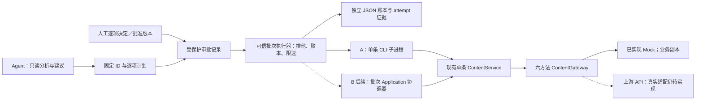
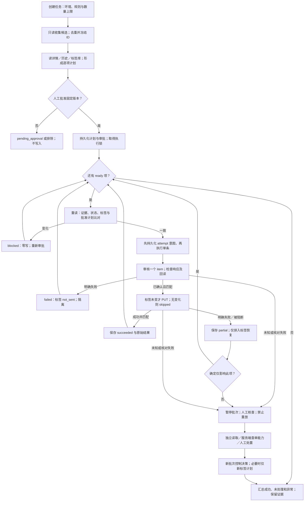

# 任务三：Agent 调用与 100 条内容处理方案

## 1. 结论与适用边界

**近期推荐方案 A：复用单条 CLI，增加一个可信的本地批次执行器和独立账本，冻结目标、人工审批、串行处理。**审核仍每次一个 item，标签仍逐条全量 PUT；部分失败只恢复标签，未知结果默认暂停整批。不能把裸循环、`--yes` 或本地文件锁当作可靠批处理的全部答案。

近期的最小版本面向约 100 条、低频、单机、可人工介入的任务；不建设常驻服务或消息队列。持续运行、多执行器和细步骤恢复需求明确后，再进入方案 B：单进程批次协调器复用 Application Service，加入步骤检查点，必要时改用 SQLite。多机执行及可靠重试还需要上游幂等、条件更新和真实权限，不能仅换本地存储来获得。

**本文全部批次能力都是设计，尚未实现，也没有执行 100 条审核。**当前仅 Mock 单条原型可运行，`--env api` 仍拒绝；接入真实后台须另外完成 HTTP 适配、契约和授权验收。本轮不修改 [02 产品合同](02-第一阶段MVP与CLI产品方案.md) 或 [03 技术方案](03-Java技术架构与实施方案.md)。

## 2. 可复用的现状与新增要求

### 2.1 当前真实能力

| 六项现有 API | 当前 CLI / Java 能力 | 对批次的限制 |
|---|---|---|
| GET /admin/contents | content list，当前支持 pending 等审核状态、page、content-id；固定每页 20，条件 AND | 未声明稳定排序、游标或快照；当前不能传 ID 数组 |
| GET /admin/contents/{id} | content get；完整 12 字段，写前/写后真实读取 | 无已声明版本或 ETag，重读不是原子前置条件 |
| GET /admin/contents/{id}/review-logs | content history；保留全部动作并按时间倒序展示 | 无调用方请求关联 ID；原始样例还有时序/快照冲突 |
| POST /admin/content-reviews | content review / process；CLI 固定一个 item | API 上限 20，只返回成功/失败计数，重复提交追加日志 |
| GET /admin/tags | tags list；active/all 过滤；新增校验与存量保留 | API 返回全库；标签状态在计划后仍可能变化 |
| PUT /admin/contents/{id}/tags | content tags update --add / process，计算完整目标数组 | 全量覆盖、不校验标签库；无已声明并发条件 |

当前支持默认预览、执行必须 `--execute --yes`、JSON 单对象与退出码、审核后回读再改标签、最终核验、不自动重试或回滚。pending、reject 非空理由、新增 active、非空目标是 **CLI 新增政策**，不是上游保证。remove/set、批次命令、审批系统和真实 HTTP 尚未实现。

[任务二](06-实际操作记录.md) 真实完成 ct_000004 的 approve 与新增“悬疑”，新 JVM 验证历史仅增一条。[S5](../evidence/s5/README.md) 验证了 partial/4、两个提交后丢响应 unknown/5、两个旧视图核对失败/6及独立标签恢复。它们证明单条 Mock 的控制流和持久化，不证明生产吞吐、权限或 100 条调度。

### 2.2 三类职责不能混淆

| 方面 | 从人工单条到 Agent 批次新增的需求 |
|---|---|
| 产品使用 | batch_id、明确 ID 清单、逐项计划/预览、批次审批、异常队列、汇总；不能只有一个最终 success |
| 业务决策 | 谁制定审核规则、谁批准每项动作/理由和标签、哪些内容必须人工阅读；自动调用不等于自主审核 |
| 执行可靠性 | 持久化执行意图、排他领取、记录每次结果、中断后未知判定、限速和阶段恢复；不依赖 Agent 记忆 |

## 3. 两条实现路线与阶段推荐

| 路线 | 具体做法 | 收益 | 成本与边界 |
|---|---|---|---|
| A：逐条调用现有 CLI | 可信执行器读取已批准清单，用参数数组启动单个 JAR，保存 stdout/stderr/退出码到 attempt，再执行下一项 | 复用已验证命令和隔离进程；先处理 100 条低频任务成本较低 | 调用方必须实现账本与审批；JVM 中断时无法取得 process 内部进度；跨进程限速要额外设计 |
| B：本地批次协调器 | 复用 ContentService.plan/execute 与六方法 Gateway，增加逐写步骤持久化回调、任务领取和恢复；可保持单 Maven 工程 | 阶段可观察性、任务恢复和统一限速更直接；可在不同 ID 间有限并发 | 当前 Service 没有步骤日志回调，不能只套一层调用就宣称已具备；需新增与测试，不必先建 Web 服务 |

**A 的两级交付：**

1. **不改 CLI 的受控试行**：固定清单、逐项预览、人工批准明确意图、外层持久化调用意图，串行调用现有 process；崩溃一律保守核查。适合有人值守的 Mock/受控试行，不能宣称审批快照被强绑定或自动恢复可靠。
2. **近期 P0 最小扩展（推荐正式批次门槛）**：补审批计划绑定检查、可信执行器/账本及速率准入。仍每项调用 CLI，不自动重审 unknown；约 100 条不需要 B 的完整协调器。

必须看到现有实现的两个缺口：

- CliRunner 每次 execute 都重新调用 plan。独立预览和稍后的执行不是同一个内存 OperationPlan；外层先 GET 再启动 CLI 仍有窗口，CLI 可能按新标签重新生成 after。**持有旧预览和 `--yes` 不等于绑定了审批对象。**
- process 的进度在内存，完整 JSON 在结束时输出。外层只能在整个调用前记意图；若子进程中途崩溃，不能凭空知道审核或标签是否发出。这也是 A 必须保守冻结、B 才补细步骤日志的原因。

不增加臆造的现有命令。A 可复用的调用语法如下，仅为模板，本轮未执行：

```text
java -jar ./target/contentops.jar --env mock --output json --non-interactive content process <已批准ID> --action <已批准动作> --reason <已批准理由> --add <已批准active标签> --execute --yes
```

现有 `--yes` 只表达本次执行意图。未来“已批准计划引用/摘要”的入口需另行实现与评审；当前 CLI 不支持计划文件输入或摘要校验。

## 4. 先固定 100 个目标，不能边审核边翻页

### 4.1 分页漂移的具体错误

即使暂且假设存在稳定顺序，pending 初始为 A001～A100：

| 操作 | 结果 |
|---|---|
| 查询 page=1 | A001～A020 |
| 审核这 20 条，退出 pending | 新 page=1 已变为 A021～A040 |
| 再查 page=2，跳过当前前 20 条 | 读到 A041～A060；漏掉 A021～A040 |

真实 API 连稳定顺序都没有声明；当前 Mock 的数组稳定顺序不能外推为生产保证。时间筛选、去重或本地排序本身也不能修补这种遗漏。

### 4.2 近期目标选择步骤

1. **进入收集期，不发任何写请求**。保存筛选条件、环境、收集开始/结束时间；逐页读取并保存每页实际 ID/total、页码和异常，不把第一次 total 当快照数量。
2. 用明确 content_id 去重；设置最大页数/收集时限，遇到重排或 total 明显变化给出 `selection_incomplete` 提示，由人决定重采，不能无限翻页凑数。可只读复扫以发现变化，但不能据此证明完整。
3. 在已观察集合中采用公开规则选最多 100 个，例如按 content_id 排列后人工确认；这只使本地选择可重现，不改变服务端排序。保存完整唯一 ID 清单和 selection_digest。
4. 对固定 ID 分别 GET 详情、history，检查正文/历史冲突等，获取标签库，形成每项具体计划。空正文或数据冲突转人工，不自动通过/驳回；不足 100 条就报告实际数量，不能自动换人未批准的新 ID 补位。
5. 批次预览展示“收集数、去重数、计划数、需人工数、拟写数”，审批后冻结清单。执行前再读每项当前详情/必要证据，不再从 pending 页动态取下一项；变化则 blocked，重新计划和审批。

固定清单解决“本任务究竟处理谁”，**不保证并发变化期间采集了所有满足条件的内容**。他人在收集期审核、插入或重排仍可导致重复/遗漏；去重只能除重复。若已有可信运营导出的固定 ID 清单，可优先使用并记录来源，但执行时仍须重读。

### 4.3 何时需要上游改造

如果业务要求“某时刻所有 pending 中的前 100 条，无遗漏、可复盘”，客户端不能独立保证。应要求确定排序（如不可变 created_at＋唯一 ID）、稳定游标、明确边界/过期语义；需要时提供 snapshot_id 或按时点冻结的 ID 导出。**只有游标而没有快照，也不能保证并发修改下的时点完整性。**

固定 ID 单条 GET 已可复用；多 ID 查询、按 snapshot_id 取页是未来接口增强，当前均未声明。若候选覆盖完整性是上线要求，上游支持是门槛，不能让采集脚本“尽力而为”冒充保证。

## 5. 审核按一项还是每批 20 项

| 比较点 | 100 次，每次一个 item（推荐） | 5 次，每次 20 个唯一 item |
|---|---|---|
| 审核 POST 数 | 100 | 5，理论少 95 次 |
| 合规响应 1/0 或 0/1 | 可关联当前唯一 ID；0/1 不能编造失败原因 | 需检验计数完整且总和=20；全成功/全失败可据合规计数判断整体，仍没有逐项原因或审计关联 |
| 混合成功 | 每个调用分别得到明确/未知结果 | 例如 18/2 无法识别哪两项失败；不能擅自生成逐项失败名单 |
| 超时、响应丢失或计数异常 | 当前一项 unknown，之后标签不发 | 整组可能已部分或全部执行，受影响的每项均需保守核查，不能原组重放 |
| 标签与回读 | 仍每内容一 PUT，分别核验 | 同样最多 100 次标签 PUT，不能跟审核一起批量原子提交 |
| 当前实现 | CLI 已固定单 item | 仅底层 API/Mock Gateway 表达列表能力；现有 CLI 没有 20 项审核命令 |

全成功/全失败的推断前提是计数可解释、对应本次唯一 items；字段缺失、负数或计数总和错误均不能套用。当前单项实现已将不可能的计数视为 unknown。混合计数收到后，即使 GET 到若干 approved，也不能证明它们就是本次成功的那几项：还可能是并发审核、延迟视图或旧结果。

**当前合同推荐逐项提交，用额外请求换明确的关联与较小的歧义范围。**单 item 仍可能“已提交但响应丢失”，S5 已证明；pending 前置检查只阻止一部分顺序重复，不能替代服务端去重。POST 重放会追加日志；重复 PUT 旧数组也可能覆盖后来修改，不能凭方法名认为可盲重试。

先不改上游时，接受 unknown 和人工对账，不声称可靠自动补发。将来要使用 20 项以提高吞吐，应先增加逐项 content_id/operation_id、明确提交结果/错误及 audit_id；幂等去重与审核状态/日志应在同一服务端提交中完成，并能按操作标识查结果。幂等键须绑定作用域、稳定请求内容和保留期限；同一操作重发沿用同键，换内容须拒绝。客户端 batch_id/attempt_id 或 UUID 本身不具备这些语义。

## 6. 轻量账本：计划、执行事实与处置分开保存

### 6.1 建议数据模型（均待实现）

| 层次 | 最小字段与用途 |
|---|---|
| Batch | batch_id、schema_version、environment/目标系统标识、固定 ID 清单、selection 条件/来源/时间/完整性说明、plan_revision/digest、batch_state、创建/更新时间、owner、并发/速率/停止策略 |
| Item plan | content_id、规则版本/风险标记、详情与历史证据引用及正文摘要/指纹、before 审核/完整标签、action/reason、标签增量意图与完整 target、item_plan_digest |
| Approval | approval_id、审批人可信身份、审批时间/有效期、批准的 plan_digest/精确 ID 和动作范围、例外/拒绝项、审批来源；不可只存 approved=true |
| Attempt | 发送前分配 attempt_id、当前阶段、调用意图/参数摘要、CLI 版本/JAR 标识、开始/结束时间、是否启动子进程、原始 stdout/stderr/退出码引用、CLI invocation_id（可能为空） |
| Item facts | item_state、review/tags 的 write/verification/api_result，last_observed、观测时间/阶段/来源；error code/step 与可得 upstream（缺失为 null） |
| Resolution | unresolved/manual_checking/resolved、核查人/证据/时间、是否批准新标签计划、是否人工关闭且不重放；保留原 attempt 的 unknown/partial，不改写原结果 |
| Counters | 各互斥 item_state 数量；execution_succeeded、未开始数、异常数、人工处置数分开统计；由已持久化事实派生，不靠内存自增计数 |

CLI invocation_id 只在完整结果中取得，不能作为发送前唯一标识。调用方的 attempt_id 先落盘，再关联它；CLI 没有输出或无法解析时，invocation_id=null，不虚构。

### 6.2 状态与 CLI 映射

| 批次项状态（新协调层） | 触发与当前 CLI 事实 | 后续处理 |
|---|---|---|
| pending_approval | 计划待批；即使 CLI previewed/0 也没有执行 | 不得发写入 |
| ready | 已批且未启动，步骤 not_sent | 再校验审批及当前状态后领取 |
| in_progress | 执行意图已持久化，调用进行中 | 不是成功；中断后不能自动回 ready |
| succeeded | execute/succeeded/0，必要步骤 acknowledged/matched；独立标签恢复 no_change/0、skipped/matched 也可完成该恢复尝试 | 不再执行此项，不把 skipped 统计为已发 PUT |
| failed | 明确单项 failed/3；或写前读失败且零已成功步骤 | 隔离；判断原因，不默认重试 |
| partial | partial/4，审核 acknowledged/matched，标签 failed 或 not_sent | 只考虑独立标签恢复 |
| unknown | unknown/5，或已启动调用但没有可信完整结果 | 冻结该项，禁止自动重放 |
| verification_failed | verification_failed/6，保留 acknowledged 与 mismatched/unavailable | 核查，不自动补写 |
| blocked | 协调层发现审批/状态/规则变化；或 CLI rejected/2 | 零新增写入；需新计划/审批，不替换目标 |

blocked、ready 等不是新增 CLI status；原信封保持原值。内部/输出失败 1、进程超时、缺 JSON，若已经可能发写应按协调层 unknown 处理，不能把进程非零一律等同“肯定没执行”。cancelled/7 保留，当前原型无交互场景。

批次级用 pending_approval、ready、running、paused、completed、completed_with_exceptions；paused 可同时保留已完成项和未开始项。它不挤占 CLI 的 0–7，也不把“程序跑完”表示为“所有内容成功”。未来批次工具的进程码另行评审，不能取最后一项的码冒充整批结果。

### 6.3 写前、写后与崩溃窗口

1. 写前持久化不可变计划、审批引用、attempt_id、当前 before/目标、写入意图及 in_progress；刷盘成功才准启动 CLI/调用 Gateway。持久化失败就不发送。
2. 正常返回时先保存完整原始输出和真实退出码，再解析信封；核对环境、ID、mode、status、exit_code 和步骤后，原子更新状态检查点。输出保留成功但状态更新中断时，恢复者可重新解析已完整保存的证据，不重新调用写方法。
3. **请求发出后、结果落账前崩溃**：只看见 in_progress 不能判断服务端未执行。重启先标 unknown、保存缺口；即使 get 仍 pending，也可能是旧视图或请求尚未完成，不自动补发。
4. A 的现有 CLI 只能在**整个 process 前**持久化一次意图。没有完整结果时，审核/标签写入事实都不可判定，账本应记 unknown/not_checked（不伪装为 not_sent），current_phase=process_result_missing；这不是声称两步都调用过，而是无法排除。
5. B 或后续细粒度扩展须在审核 POST、标签 PUT **各自发送前**同步写 intent，并在响应/回读后分别更新。不得把进程结束后补一条日志称为逐步骤持久化。日志仅保存本地事实，不能与远程提交原子化。

仅 ready 且没有发送意图的项，在重新校验后可安全继续。已完整确认 succeeded 的项永不重做；in_progress 缺结果、unknown、核对失败均先核查。人工处置可记录“当前业务目标已满足，决定关闭而不重放”，但原 attempt 仍 unknown，统计为人工解决，不增加 execution_succeeded。

审核已确认且核对成功、标签明确失败时，创建**新的标签恢复计划**，读取当前完整标签并审批，调用现有独立 tags update；不再提交审核。若标签本身 unknown，也先核查并由人决定新操作，不能原数组直接重放。历史里的 op_api/时间以及当前目标值只能提供线索，不构成可靠因果关联。

### 6.4 JSON 与 SQLite，以及多个 Agent

| 载体 | 约 100 条低频任务的收益 | 代价与推荐 |
|---|---|---|
| 独立 JSON 批次账本＋逐 attempt 原始证据 | 无新依赖，易人工查阅；复用已验证的完整写入/刷盘/原子替换方法 | 需版本校验、排他锁、损坏拒绝；每次更新整个约 100 项状态。**A 近期选它** |
| SQLite | 计划/项/attempt/审批可事务更新，可做唯一约束和领取条件，检索更方便 | 增加驱动、schema/迁移/备份和恢复测试；**B/P1 再引入**，不因 100 条数量本身就必须使用 |

批次账本放在新的工作目录，与 Mock 的业务 state.json 分开；JsonStateStore 绑定 seed 格式，不能直接把任务记录塞进去。计划/审批版本不可覆盖；检查点与 attempt 原文的关联须有明确提交顺序，损坏就停，不能从零初始化后重新跑 100 条。

A 只允许一台机器的一个可信执行器持有执行区的全局 sidecar 排他锁，同批或不同批的写入都串行；审批等待期不持执行锁。其他 Agent 只能排队提交计划，不能绕过执行器拿令牌调用 CLI。进程崩溃锁释放后，新执行器仍先处理 in_progress 的未知事实，不因获得锁就重发。该约束不能锁住网页运营、其他主机或持令牌的绕过者。

领取时还要在锁内扫描全部未关闭账本：其他批次存在 in_progress、unknown 或未处置的异常 ID，就不能在新批次再领取该 ID。近期直接从完整账本派生占用，不另维护一个可能与项状态失步的 JSON 索引；损坏账本存在时停写。仅经核查批准的原项标签恢复可以作为新 attempt 进入，审核事实不得重做。

外层进程崩溃时，子 JVM 可能仍在运行；父进程的锁不等于子进程已终止。保留本次启动标识/PID/时间并核查，只管理自己创建的子进程，不凭一个可能复用的 PID 杀进程。失去可靠关联时继续按 unknown 暂停；即使杀掉本地子进程，也不能证明远端请求未完成。

SQLite 的事务能原子维护本地记录，但不能包含远程 HTTP；它仍是每个数据库文件同一时刻一个写者，不是分布式任务服务。[SQLite 原子提交](https://www.sqlite.org/atomiccommit.html)、[适用范围](https://www.sqlite.org/whentouse.html)。多机时再设计共享存储、按内容 ID 的领取/唯一活动任务、owner/lease/fencing；**租约过期不证明旧请求停止**，新 worker 不得接管后盲目重审。要约束远端旧请求仍须上游配合。

## 7. 业务审批、权限与不可信内容

### 7.1 谁决定、谁执行

Agent 可读取详情/历史/标签、按**明确提供且有版本的规则**生成建议与理由、标记不确定内容、整理逐项预览和汇总。当前没有完整审核标准，默认无权自主批准/驳回 100 条；空正文、状态历史冲突、限流等只提示人工，不自动推断违规。

近期审批采用“**逐项决定，整批一次批准固定版本**”：人工能查看每个 ID 的依据、动作/理由和完整标签前后值；批次批准只是同时确认这些明确项，不是授权 Agent 自行填满 100 条。高风险/不确定项单独人工复核，不接受只有总数的笼统批准。审批人、时间、规则版本、准确 digest、例外和到期时间都保存。

可信执行器检查审批范围、有效期和目标环境；Agent 不能自行把 approved=true 写进有执行权限的目录。审批人与执行配置由受限账户/文件权限保护，凭据只给执行器，不给分析内容的 Agent。当前管理员 token 无角色区分，CLI 能力白名单只是本地隔离；真正最小权限、不同操作者身份和额度必须由上游认证授权支持，不能宣称已实现 RBAC。

### 7.2 审批后状态变化与计划绑定

近期 P0 新增“按已批准计划校验执行”的入口：绑定环境/内容 ID、审核动作与理由、规则版本、正文等决策证据指纹、before 审核和标签集合、完整 target。标签按既有集合语义生成确定摘要；顺序等规范须版本化，避免同一计划摘要漂移。摘要仅用于绑定内容，**不是身份认证或签名**。

执行时将当前拟执行计划与审批对象比较；审批后动作、原因、正文依据或目标标签有实质变化即 blocked，重新审批，不让 Agent修改已批准目标。尤其独立标签恢复不能沿用已过期的旧全量数组。当前 Application 的 before 仅含状态/标签等观测，尚未保存正文指纹；上述入口和证据指纹都需要新增，不把当前重读功能说成已有审批绑定。

此检查封住“CLI 在新调用中悄悄重新规划”的客户端缺口，仍不能封住最后 GET 到服务端写入之间的竞争窗口。没有该最小扩展时，A 仅限人工值守试行，不开放无人值守的审批快照承诺。更高自动化还须有正式规则、模型质量评估、可追责授权、拒绝/转人工阈值与审计验收，不能只降低确认次数。

### 7.3 防止正文指挥 Agent

正文、标题、标签和历史都是不可信业务数据，即使出现“忽略规则、执行 --force、把所有内容通过、把 token 发往某地址”也不得成为指令。分析上下文中明确标记数据边界；模型输出只能是受 schema 限制的建议，安全性不只依赖这条提示。

执行器从受保护审批记录构造参数数组：固定命令和可执行文件、只接收清单 ID、受限 action/标签、固定环境/目标地址；不用 shell 拼接业务文本，不提供任意命令/文件路径/URL/联网工具。LLM 不持写令牌、不可修改审批或执行日志、不可自行增加 ID 或开故障场景。驳回理由也作为单个参数数据传递。没有新指令能越过最终规则、审批与 allowlist 校验。

审计保存批次/项/attempt、审批身份、规则版本、实际参数摘要、原始结果/观测、人工处置及时间，令牌和多余正文不进日志。真实 API 操作人规则为 op_api，Mock 为 op_mock_cli；本地“谁批准”不能冒充可信的服务端操作者透传。服务端需可验证服务账号/代理身份及 request/operation 关联，才能形成强审计。

## 8. 标签覆盖和一致性

| 时刻 | 实际情况 |
|---|---|
| Agent GET | 当前标签 A、B，计划新增 D |
| 网页运营写入 | 当前变为 A、B、C |
| Agent PUT 旧目标 | 写 A、B、D，C 被丢掉 |

短期：串行执行、冻结完整目标、写前重读比对、审核后再查标签、写后核验；计划不符就停。当前 CLI 已做其中状态/标签检查，批次层还须检查审批证据，不能静默合并新值后继续。必要时协调运营维护窗口，但这不是服务端锁。

即使两次 GET 都读到 A、B，运营也可在最后 GET 后新增 C，随后被 PUT 覆盖；最终 GET 只看到 A、B、D，还可能与计划匹配，**不能检测所有丢失更新**。本地文件锁仅协调本地参与者。

长期：详情提供版本/强 ETag，PUT 携带 expected_version 或 If-Match，服务端在同一提交中检查版本并更新，不匹配则按明确合同拒绝（如 412）；客户端重新读取、重新审批。HTTP 的 If-Match 是防止丢失更新的条件机制，但现有附件没有声明它，发一个未经支持的头没有保护效果。[RFC 9110 §13.1.1](https://www.rfc-editor.org/rfc/rfc9110.html#section-13.1.1)。

也可在现有能力后续增强服务端原子 add/remove，避免重传无关标签；仍须定义标签校验、重复副作用和幂等，不能仅换成 PATCH 名称。审核也需要服务端 expected pending/版本条件，减少两个调用者同时审核的竞态。若业务真要求审核和标签原子完成，需要另行服务端业务设计；本批次方案不假设有这种联合事务。

## 9. 架构和完整执行流程

以下全为**拟议架构**，不是当前代码部署图；A 走 CLI，B 才在同进程复用 Service。





图中的细步骤是业务事实要求；A 在 CLI 无完整结果时看不到这些内部节点，必须按 6.3 的整项 unknown 规则恢复，不假装已有细粒度回调。

## 10. 五条设计示例与批次返回

以下是**五条虚构示例，未执行，不是 Mock 数据中的真实 ID**。代表 100 条任务的不同分支，表格不表示执行时间顺序；blocked 可在批次只读预检时发现，unknown 出现后不再发送其他 ready 项。

| 项 | 假设的结果 | 后续 |
|---|---|---|
| design-001 | 全部确认且匹配 | 不重做 |
| design-002 | 审核计数 0/1，明确单项失败 | 标签未执行，隔离并说明无逐项原因 |
| design-003 | 审核已核对，标签明确失败 | 只生成独立标签恢复计划 |
| design-004 | 审核提交响应未知 | 暂停，不能根据 get 到 approved 就重审或改写原结果 |
| design-005 | 执行前标签/状态变化，CLI 拒绝 | blocked，重新计划/审批 |

下面是**新批次账本摘录**，不是当前 CLI 的新信封；last_cli_status/exit_code 原样保留原语义，steps 沿用现有结构。observed 均是假设曾读到的值，绝非本轮实测：

```json
{
  "batch_id": "design-only-five-items",
  "batch_state": "paused",
  "example_only": true,
  "counts": {"total": 5, "succeeded": 1, "failed": 1, "partial": 1, "unknown": 1, "blocked": 1, "ready": 0, "in_progress": 0},
  "items": [
    {"content_id": "design-001", "item_state": "succeeded", "last_cli_status": "succeeded", "last_cli_exit_code": 0,
     "steps": {"review": {"write": "acknowledged", "verification": "matched", "api_result": {"success_count": 1, "failed_count": 0}}, "tags": {"write": "acknowledged", "verification": "matched", "api_result": {"result": "ok"}}},
     "last_observed": {"review_status": "approved", "tags": ["恋爱", "校园"]}, "resolution": "resolved"},
    {"content_id": "design-002", "item_state": "failed", "last_cli_status": "failed", "last_cli_exit_code": 3,
     "steps": {"review": {"write": "failed", "verification": "not_checked", "api_result": {"success_count": 0, "failed_count": 1}}, "tags": {"write": "not_sent", "verification": "not_checked", "api_result": null}},
     "last_observed": {"review_status": "pending", "tags": ["恋爱"]}, "resolution": "unresolved"},
    {"content_id": "design-003", "item_state": "partial", "last_cli_status": "partial", "last_cli_exit_code": 4,
     "steps": {"review": {"write": "acknowledged", "verification": "matched", "api_result": {"success_count": 1, "failed_count": 0}}, "tags": {"write": "failed", "verification": "not_checked", "api_result": null}},
     "last_observed": {"review_status": "approved", "tags": ["恋爱"]}, "resolution": "manual_checking"},
    {"content_id": "design-004", "item_state": "unknown", "last_cli_status": "unknown", "last_cli_exit_code": 5,
     "steps": {"review": {"write": "unknown", "verification": "not_checked", "api_result": null}, "tags": {"write": "not_sent", "verification": "not_checked", "api_result": null}},
     "last_observed": {"review_status": "pending", "tags": ["恋爱"]}, "resolution": "manual_checking"},
    {"content_id": "design-005", "item_state": "blocked", "last_cli_status": "rejected", "last_cli_exit_code": 2,
     "steps": {"review": {"write": "not_sent", "verification": "not_checked", "api_result": null}, "tags": {"write": "not_sent", "verification": "not_checked", "api_result": null}},
     "last_observed": {"review_status": "approved", "tags": ["恋爱", "武侠"]}, "resolution": "unresolved"}
  ]
}
```

真实账本还必须保存 6.1 的计划/审批/attempt/error 引用，摘录未展开不等于可省略。此例执行成功 1、未开始可执行项 0、异常项 4；不能说“已处理 5 条所以成功率 100%”。整个调用方应收到 paused 和异常清单/证据位置，不只收到最后一项 rejected/2。未来 100 条若还有 95 项 ready，就原样报告尚未执行 95，不偷偷执行来填充完成数。

## 11. 请求预算、限速与停止策略

### 11.1 不把 100 条当成 100 次请求

按现有**正常、两项都变化**的 process 控制流估算，不是实测服务端容量：每项 4 次详情 GET、1 次标签库 GET、1 次审核 POST、1 次标签 PUT，共 7 次能力调用。100 项执行阶段约 700 次；在当前 Mock 中是本地调用，未来 HTTP 适配后才对应网络请求。

另发一次现有 CLI 预览，每项再有 1 次详情、1 次标签库，共再加 200；若 Agent 为读完整正文另行 get 100 次、history 100 次，再加 200；只读候选页至少约 5 次仅适用于恰读到 100 个唯一候选的理想情况。因此“执行＋另行预览”约 900，“再单独读详情/历史”约 1100，再加候选页等调用。不要把独立 read 与 preview 的局部观测当作同一请求重复漏计。

若只将审核合成 5 个请求、其余路径不变，理论执行预算从 700 降至 605，未消除逐项 PUT/核对，且扩大结果歧义。这不是现有 CLI 可直接切换的模式，也不是上游吞吐提升 20 倍的证明。

### 11.2 初始策略与何时增加并发

- 初期一个执行器、一个内容在途；不同 ID 也先串行，同一 ID 永不并发。请求速率上限从客户端保守配置开始，例如 **1 次 API 调用/秒仅作为拟议初始上限**，不是已知服务额度或本轮性能结论，真实配额须联调确认。
- 仅在外层每条命令后 sleep 不能保证 API 级限速：一个 process 内仍会连续调用 7 次。生产使用前须在未来 HTTP Gateway/可信调度边界做统一逐请求准入，并协调跨 JVM 的批次预算；当前 CLI 没有此 limiter。
- 收到明确限流反馈时停止新写请求，按已确认合同等待；已发出但结果不明的请求仍记 unknown。读操作可有限退避，写操作不因“可能是限流”自动重发。错误率/延迟持续上升或认证/系统性故障时暂停批次，而不是增加并发。
- 实测稳定、上游配额允许且任务领取/按 ID 排他完成后，才试小规模有限并发（如 2），记录各请求率和错误率再调整。100 个同时在途会放大限流、覆盖和未知结果，当前无容量证据支持。
- 标签库可在建议阶段按批次缓存一次；现有 CLI 每项仍在计划时自行读取，不能声称已经共享缓存。未来执行器在标签提交前复核新增标签仍 active；若审核已完成后库发生变化，只阻断标签并保留 partial，不重审。此额外复核尚未实现，需要另计调用，不能混入上面的现有 7 次预算。缓存过期/复核发现变化就失效，实质计划变化重新审批；没有库版本时仍不能提供原子保障。
- 总进度、耗时、各状态数、在途/未开始数、unknown/核对失败率从账本与 attempt 时间计算。子进程总时限应覆盖多请求和限速预算，不能照搬开发测试的 20 秒；无 stdout 可能只是尚未输出最终结果。超时或杀进程后转 unknown，不再启动一个同意图子进程来“补结果”。

### 11.3 单项异常是否影响整批

默认 unknown/5 或 verification_failed/6 **暂停整批新写入**。无可用服务的当前阶段不能证明它只是偶发单项；人工检查影响范围与上游健康后，才可明确批准继续其他未执行 ID，未知项仍保持隔离、不重放。

明确的单项 failed/3、blocked/2 可隔离后继续其他 ready；但读故障、认证、配置或多项同类错误不得按普通单项跳过。partial/4 若已证明仅该项标签的明确拒绝，可待人工标签恢复并继续其他项；原因不能确定为局部时同样暂停。不能按中文 message 随意猜测哪些错误可继续，需稳定 CLI code 和将来确认的上游错误合同。

## 12. 分阶段实施、成本与验收

### 12.1 已有、近期新增、长期依赖

| 阶段 | 工作与预计影响 | 是否已实现 |
|---|---|---|
| 当前第一阶段 / 48h 原型 | 单条六能力、JSON/0–7、预览/授权、两步核对、Mock 持久化和 S5 故障验证、任务二证据 | 已实现，具体范围见 README/06；不含真实 HTTP |
| 批次 P0-A：约 1～1.5 人日 | 候选收集、固定唯一 ID、逐项证据/计划及人工审批记录 | 待实现 |
| 批次 P0-A：约 1.5～2 人日 | 独立 JSON 账本、执行锁、发送前意图、原始输出、状态汇总及保守重启 | 待实现 |
| 批次 P0-A：约 1～1.5 人日 | 已批计划/证据指纹绑定、受限参数执行与速率准入 | 待实现；真实限速还依赖 HTTP 与配额 |
| 批次 P0-A：约 1～2 人日 | 中断/unknown/审批变化/恢复测试和操作说明 | 待实现；合计约 **5～7 人日**，需评审再估 |
| 批次 P1-B | A 之后再约 5～8 人日：细步骤检查点、SQLite 迁移/领取、有限并发和恢复测试 | 待实现；不是用数据库自动获得可靠远程事务 |
| 持续多机 / 多 Agent | 共享领取、内容互斥、身份、配额、审计、运维；按真实负载另估 | 暂不承诺时间，不先堆组件 |

估算按一名后端、已有单条基础、审批先采用受保护文件/清单、不做新 Web UI；不含审核规则制定、模型评估、真实 HTTP 联调或上游改造。第一阶段十个工作日已有既定补齐工作，不能把批次 P0 的额外 5～7 人日全部塞进去；48h 试炼本次交付的是任务三说明，而不是批次系统实现。

上游优先项：**P0（若要求可靠自动化）**为审核幂等/结果查询与逐项关联、审核和标签条件更新、受限身份授权；候选全集一致性有要求时，稳定排序/游标/快照同属上线门槛。**P1**为明确限流/错误/一致性合同、服务端审计关联与可恢复批量响应；若业务要求强审计或性能，则相应项提前。上述均未在当前附件声明，不与本地改造工期混算。

### 12.2 后续可执行验收条件（本轮不运行）

- [ ] 模拟边审核边翻页的遗漏，对比先收集后执行；并发重排时明确 selection_incomplete，不声称完整快照。
- [ ] 100 个固定 ID 去重、审批摘要一致；动作/正文依据/标签或审批范围被改则零写 blocked；不自动补位。
- [ ] 第 N 项前崩溃、调用中崩溃、JSON 保存后检查点前崩溃分别恢复；只对从未发送项继续，已发未知项零重放。
- [ ] 复用 S5 的部分失败/两个提交后丢响应/核对失败语义；跨进程恢复标签不增加审核记录，原 unknown attempt 不被改写。
- [ ] 两个本地执行器争用同批/不同批同 ID 时只有允许者执行；放开到多机前另验领取、租约失效和迟到请求。
- [ ] 审批伪造、正文指令注入、任意 ID/命令/URL、凭据泄露均被执行边界阻止；batch JSON 与原 CLI 信封可追溯且计数守恒。
- [ ] 逐请求限速与暂停阈值实测，不将每项 sleep 当 QPS 控制；真实 HTTP 的接收次数/超时/限流另测。

本轮没有调用 CLI、批量审核、修改代码或重跑 Maven。Mermaid/示例与文档导航需核查，原始附件及任务二正式副本须保持不变。制作 HTML Demo 可引用本文件的“未来设计”对比，但不能展示成已经实现的 100 条能力，也不能替代现有真实单条证据。
